# UEFI SECURE VAULT SUITE

UEFI Secure Boot key/PKI lab with Auth2 variable updates, EDK2 apps, Win32 diagnostics, and a QEMU/OVMF lab with swtpm TPM 2.0 measured boot, SMM, VBS/HVCI, IOMMU, and a test suite.

The UEFI Secure Vault Suite is an integrated, low-level security research environment and cryptographic toolchain designed to explore, audit, and simulate the hardware-enforced boundaries of UEFI Secure Boot, the GUID Partition Table (GPT) layout, System Management BIOS (SMBIOS) data structures, and Windows Virtualization-Based Security (VBS / HVCI).

This repository provides an automated end-to-end framework to construct a private Certificate Authority, sign custom boot assets, bypass hardware constraints inside a virtualized environment, and trace the cryptographic execution path from raw hardware registers up to the running Windows Kernel.

## Toolset Directory & Component Index

### 1. Host Automation & Build Scripts (.sh)

- `00_download_windows_iso.sh`: Curls a vanilla evaluation ISO (`windows10_vanilla.iso` or `windows11_vanilla.iso`). This is not a Microsoft REST client. The built-in placeholder URL is `https://microsoft.com` and must be replaced with `--url <https://...>` before a live pull. `--win10` and `--win11` select the output name.
- `01_setup_certs.sh`: Generates a custom testing cryptographic public key infrastructure (PK, KEK, db) using RSA-2048 encryption and bundles them into standard binary EFI Signature Lists (`.esl`). No arguments. Private keys stay under `workspace/certs/`.
- `02_run_qemu.sh`: Boots QEMU+OVMF with the workspace FAT volume as `FS0:`. Firmware is staged as a matching CODE+VARS pair under `workspace/ovmf/` (SMM and swtpm TPM 2.0 are on by default). `--nested` forces VBS/HV enlightenments and raises the default guest to 4096 MiB / 4 vCPUs (historical name: `qemu_nested.sh`). `--memory` and `--smp` override the guest shape. Shared lab flags are listed under [QEMU lab features](#qemu-lab-features).
- `03_generate_auth_update.sh`: Merged dynamic payload builder. It accepts a fingerprint or a binary, a variable target (`db`, `dbx`, `PK`, or `KEK`), and a time-stamping flag (`--static` or `--dynamic`) to construct signed `EFI_VARIABLE_AUTHENTICATION_2` (`.auth`) update containers. A signed second offset such as `-7200` backdates a dynamic packet so the `dbt` counter can reject it. Historical names, no longer in this tree: `03_generate_auth_update_2.sh`, `03_generate_auth_update_3.sh`, and the incremental-date generators.
- `04_extract_ms_certs.sh`: Uses `sbattach --detach` to non-destructively isolate the default embedded Microsoft PKCS#7 certificate chain (`workspace/certs/extracted/ms_winboot_signature.p7b`) from an unmodified bootloader. Optional argument is the path to `winboot.efi`.
- `05_sign_custom_winboot.sh`: Strips vendor signatures from a target `winboot.efi` and signs the copy using the local test `db` certificate via `pesign`. The vendor original is left untouched so step 04 can still read it.
- `06_hash_cert_for_nvram.sh`: Polymorphic script that parses either `.cer` / `.crt` files or `.esl` packages, strips headers automatically, and outputs a compressed, raw 32-byte binary lookup token (`cert_fingerprint.bin`). Any other extension is hashed as raw file bytes.
- `07_extract_certs_to_esl.sh`: Converts extracted public `.p7b` containers into standalone `.crt` and `.esl` assets so a native chain can be re-injected into the virtual environment.
- `08_cosign_application.sh`: Applies multi-signature layouts to a single `.efi` binary, appending an independent cryptographic trailer to test sequential Image Loader gate structures. Optional arguments are the input signed image and the co-signed output.
- `09_sign_db_with_kek.sh`: Packages an existing whitelist `.esl` into an `.auth` envelope signed explicitly by the custom KEK private key, so the update can cross a User Mode lockdown. Optional arguments are the `.esl` path and `db` or `dbx`.
- `10_simulate_integrity_violation.sh`: Clones an authenticated packet and intentionally flips internal bytes, creating a signature violation to test hardware verification failures. Optional arguments select the valid packet and the corrupted output.
- `11_extract_and_patch_iso.sh`: Unpacks a vanilla installation disk image, embeds the automated unattend script, injects the custom-signed bootloader, and recompiles a deployment ISO (`windows_patched.iso`). Modes are `--extract`, `--patch`, `--rebuild`, `--all` (the default: extract + patch + rebuild), `--clean`, and `--force`. The unpacked tree is kept by default; `--keep-tree` is accepted and ignored. Stamps in `tmp_iso_extract/` (`.stamp_extract`, `.stamp_patch_iso`, `.stamp_winpe`) make reruns idempotent. `--iso`, `--signed-efi`, and `--output` select the media, the replacement loader, and the output image.
- `12_run_patched_iso_qemu.sh`: Boots the patched ISO on a persistent qcow2 disk. This script stages OVMF itself; a prior `02_run_qemu.sh` run is no longer required, but an existing root `OVMF_VARS.fd` enrollment is migrated when safe. VBS/HV enlightenments default to auto (on when KVM and nested virtualization are available). `--no-nested` turns them off. `--memory`, `--smp`, and `--disk` shape the guest. Shared lab flags are listed under [QEMU lab features](#qemu-lab-features).
- `13_patch_winpe_image.sh`: Mounts `boot.wim` index 2, injects the Win32 user-mode diagnostics into `System32`, applies `winpeshl.ini`, and stages the `.efi` applications on the media root. Restores `boot.wim` from `tmp_iso_state/boot.wim.orig` before a redo so injections do not stack, and writes `.stamp_winpe` so a matching rerun is a no-op. The optional argument is the unpacked ISO directory, default `tmp_iso_extract`.
- `14_compile_win32_diagnostics.sh`: Cross-compiles the Ring 3 verification tools from Linux with `x86_64-w64-mingw32-g++ -O2 -static`, and stages the executables in `workspace/`.
- `deploy_suite.sh`: Orchestrates the EDK2 build of `SecureManagerApp` and `SignatureParserApp` and stages the `.efi` binaries into `workspace/`. In this tree the same script is also named `15_deploy_uefi_apps.sh`. `EDK2_ROOT`, `TARGET_ARCH`, `TARGET_TOOLCHAIN`, and `BUILD_TARGET` are environment overrides.
- `16_verify_signatures.sh`: Host-side OpenSSL inspection of a detached `.p7b`, an X.509 certificate, an `.esl` header, or a CMS blob. Modes are `p7b`, `x509`, `esl`, and `cms`.
- `build_uefi.sh`: Probe-and-install wrapper that builds `SecureManagerApp.efi` and `SignatureParserApp.efi`. It can install QEMU, OVMF, swtpm, and EDK2 dependencies when they are missing. No arguments. Environment: `EDK2_ROOT`, `EDK2_TAG`, `TARGET_ARCH`, `TARGET_TOOLCHAIN`, `BUILD_TARGET`.
- `build_win32.ps1`: Windows-host equivalent of `14_compile_win32_diagnostics.sh`. Writes objects and executables under `win32/build` and copies `.exe` files into `workspace/`.
- `tests/run_tests.sh`: Runs the pytest suite (`tests/test_*.py`): Auth2 packet structure, ISO/WinPE idempotency, QEMU dry-run command shape, OVMF mismatch abort, and a headless OVMF+swtpm boot when the toolchain is present.

### 2. Native UEFI / EDK2 C Applications (.c & .inf)

- `uefi/SecureManagerApp/SecureManagerApp.c` and `.inf`: On-device interactive shell application. A scroll-selection menu enrolls an open-path whitelist (`.esl`), injects a User Mode enveloped update (`.auth`), appends a blacklist entry, or runs the emergency hardware reset wipe. The banner prints Setup Mode or User Mode and the live `dbt` anti-replay counters. Destinations are `P` (PK), `K` (KEK), `D` (db), and `X` (dbx). Historical names, no longer in this tree: `SecureManagerApp_2.c`, `SecureManagerApp_facxtory_reset_part.c`, and `SecureManagerApp_PrintLiveTimestampCounters_part.c`.
- `uefi/SignatureParserApp/SignatureParserApp.c` and `.inf`: Low-level parsing engine that decodes binary `.esl` and `.auth` layouts, classifies X.509 and SHA-256 lists, prints owner GUIDs, and walks raw SHA-256 blacklist entries. It also prints the three-gate Image Loader diagram before the file menu. Historical name, no longer in this tree: `SignatureParserApp_2.c`.

### 3. Native Win32 C++ Diagnostic Source Files (.cpp)

These binaries are the Windows-side half of the same chain. They do not enroll keys. They read the objects the firmware already stored, and they show where the running kernel stops forwarding a write.

- `win32/LowLevelBootTools.cpp`: Single elevated inspector. It opens the hidden EFI System Partition through `\\?\GLOBALROOT\SystemPartition\`, lists the ESP root (`--list-root`) and `EFI\Microsoft\Boot` (`--list-boot`), parses `bootmgfw.efi` and runs `WinVerifyTrust` (`--parse-boot-file`, alias `--parse`), copies the loader (`--extract-boot`) and its Authenticode table (`--extract-sig`), copies and enumerates the BCD hive (`--extract-bcd`, `--inspect-bcd`), writes a timeout onto a hive copy (`--modify-timeout`), dumps `PK`, `KEK`, `db`, `dbx`, and `dbt` (`--extract-all-keys`, alias `--extract-hardware-keys`), walks an EFI Signature List (`--parse-esl`), exports the first certificate entry (`--esl-to-cer`), and dumps the raw SMBIOS table (`--dump-smbios`). Historical names, no longer in this tree: the `Extract_bootmgfw*` series and the `LowLevelBootTools_extract_esl`, `_wincrypt_cer`, `_wincrypt_cer_extended`, and `_dump_smbios` parts.
- `win32/ParseSmBios.cpp`: Typed SMBIOS viewer. `--parse-smbios` walks Type 0 (BIOS vendor, version, date) and Type 1 (system manufacturer, product, serial, UUID) through the trailing string pool. `--dump-smbios` on `LowLevelBootTools.exe` is the raw buffer. This tool is the decoded view of that buffer.
- `win32/WinVerifyTrust.cpp`: Standalone Authenticode check. The only parameter is the file path. It calls `WinVerifyTrust` with UI disabled and revocation checks off, and prints trusted, unsigned, disallowed, or trust-provider failure. `LowLevelBootTools.exe --parse-boot-file` calls the same API after it has already parsed the PE security directory.
- `win32/VerifyRuntimeBoundaries.cpp`: Acquires `SE_SYSTEM_ENVIRONMENT_NAME` from user space, reads the active `db` whitelist, and attempts an unauthenticated write of the Platform Key. On a VBS-capable boot the write is dropped by the executive, because the request cannot cross from VTL 0 into VTL 1. No switches.
- `win32/AuditMeasuredBootLog.cpp`: Talks to the TPM through TPM Base Services (`tbs.lib`), pulls the TCG boot log, and prints a focused attestation report for PCR 0, 4, 7, and 11. `--all` is accepted by the usage text but is a no-op: `wmain` never branches on it, so the report is always the focused PCR set. A guest with no TPM fails `Tbsi_Context_Create` in the open, which is a recorded result, not a hidden error. Historical name, no longer in this tree: the second `AuditMeasuredBootLog` revision as a separate file.
- `win32/DumpNtfsVolume.cpp`: Opens `\\.\C:` with share-read and share-write, issues `FSCTL_GET_NTFS_VOLUME_DATA`, and dumps the `$MFT` at `MftStartLcn`. `--volume` selects the volume. `--bytes` selects the dump length. A valid record starts with the `FILE` magic. This is the raw-volume path described by the original notebook and shipped here as its own tool.

### 4. Configuration Manifests (.xml & .ini)

- `autounattend.xml`: Pre-installation answering matrix. It instructs Windows Setup to skip the lab hardware checks (TPM, RAM, Secure Boot, storage, CPU) so the QEMU install can finish, and it is the hook point for Virtualization-Based Security (VBS) and Hypervisor-Protected Code Integrity (HVCI) on first boot. These bypasses are setup policy. They do not turn Secure Boot off in firmware.
- `winpeshl.ini`: Shell interception descriptor. WinPE launches `VerifyRuntimeBoundaries.exe`, then `AuditMeasuredBootLog.exe`, then `setup.exe`, instead of dropping straight into the standard setup wizard.
- `MdeModulePkg.dsc`: Component declaration block required to link the application workspaces into the EDK2 compilation path. `deploy_suite.sh` appends the two INF lines when they are absent.

## Architectural Overview & Testing Methodologies

The suite is engineered to isolate system constraints across three execution environments.

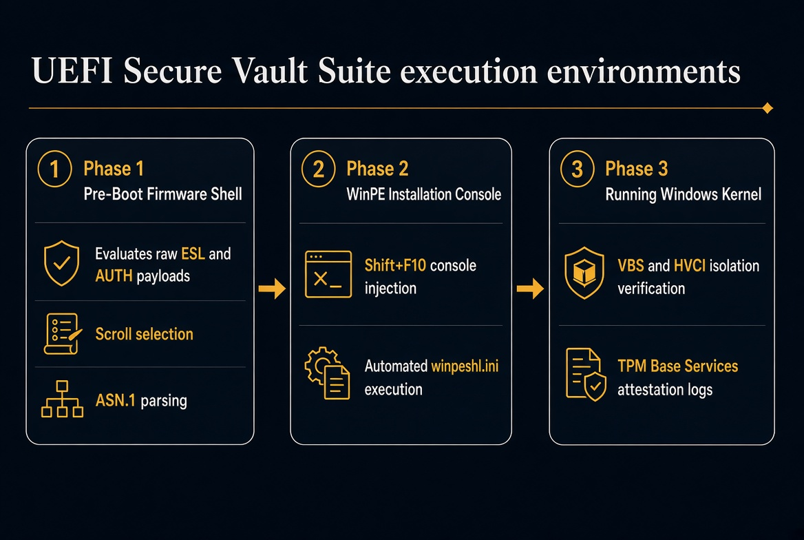

Method 1: Pre-Boot Firmware Validation (`.efi`)

In this environment the primary enforcement layer of the motherboard is tested before the operating system initializes.

- The Workflow: Run `01_setup_certs.sh` to generate key pairs, launch `02_run_qemu.sh`, and enter the native EFI Internal Shell.
- The Verification: Launch `SecureManagerApp.efi` and `SignatureParserApp.efi`. If the virtual motherboard is in Setup Mode, variables can be written freely. Enrolling a PK transitions the system into User Mode and locks NVRAM. Later updates are rejected unless they pass through Option 2 as an authenticated `.auth` packet from `03_generate_auth_update.sh`.

Method 2: Offline Windows Preinstallation Environment (WinPE)

This environment tests code integrity as the setup environment takes over system memory.

- The Workflow: Execute `14_compile_win32_diagnostics.sh`, then `./11_extract_and_patch_iso.sh --extract --patch`, then `13_patch_winpe_image.sh`. That mounts `boot.wim`, injects `VerifyRuntimeBoundaries.exe` and `AuditMeasuredBootLog.exe`, and applies the `winpeshl.ini` hook. Rebuild with `./11_extract_and_patch_iso.sh --rebuild` and boot with `12_run_patched_iso_qemu.sh`.
- The Verification: WinPE bypasses the QEMU hardware floor and opens a privileged `cmd.exe` before the Windows setup panel. `VerifyRuntimeBoundaries.exe` audits how the Windows executive protects firmware variables before a single file is committed to the main partition.

Method 3: Live OS Memory Attestation & Hyper-V Verification

This environment tests the highest layer of defense: Virtualization-Based Security.

- The Workflow: Let the patched ISO finish installing onto the virtual disk. `autounattend.xml` carries the lab setup policy, and `12_run_patched_iso_qemu.sh` exposes the nested Hyper-V enlightenment bits the guest needs before it will start its own hypervisor.
- The Verification: Once the full Windows desktop is up, `AuditMeasuredBootLog.exe` interfaces with the virtualized TPM, copies the TCG event stream, and writes the attestation report: whether Secure Boot policy events are present, whether a `db` / `dbx` authority event was measured, and whether the focused PCR set is intact. `VerifyRuntimeBoundaries.exe` is the matching write-path test for Virtual Trust Level 1.

## Quick-Start Laboratory Deployment Guide

To execute a complete end-to-end simulation pipeline (downloading, signing, repatching, and verifying an automated Windows 11 installation under customized Secure Boot conditions), run the following sequence from the repository root.

```
# Step 1: Download vanilla evaluation media. This is a curl of --url, not a
# Microsoft REST client. The placeholder is https://microsoft.com and must be
# replaced with a real evaluation ISO URL.
./00_download_windows_iso.sh --win11 --url https://example.invalid/windows11.iso

# Step 2: Extract the original bootloader from the downloaded ISO
mkdir -p tmp_mnt && sudo mount -o loop windows11_vanilla.iso tmp_mnt
cp tmp_mnt/efi/boot/bootx64.efi workspace/winboot.efi
sudo umount tmp_mnt && rmdir tmp_mnt

# Step 3: Initialize your private testing Certificate Authority keys
./01_setup_certs.sh

# Step 4: Isolate original vendor certs and sign the loader with your custom db keys
./04_extract_ms_certs.sh
./05_sign_custom_winboot.sh

# Step 5: Cross-compile your Ring 3 diagnostic executables from the host
./14_compile_win32_diagnostics.sh

# Step 6: Unpack and patch the media tree, then inject WinPE diagnostics
./11_extract_and_patch_iso.sh --extract --patch
./13_patch_winpe_image.sh

# Step 7: Rebuild windows_patched.iso from the existing tree (keeps the WinPE injection)
./11_extract_and_patch_iso.sh --rebuild

# ISO-only path (no WinPE injection): unpack, patch, and rebuild in one step
# ./11_extract_and_patch_iso.sh --all

# Step 8: Launch the nested hypervisor environment to begin analysis
./12_run_patched_iso_qemu.sh
```

Step 6 unpacks and patches the tree (`--extract --patch`) and then injects WinPE. Step 7 must be `--rebuild` only: a second `--all` would try to extract again and, once `.stamp_winpe` is present, refuse unless `--force` is passed. `--all` is the ISO-only path when you do not need WinPE. The tree is kept by default; `--clean` deletes `tmp_iso_extract/` and `tmp_iso_state/`. `deploy_suite.sh` is the missing compile step when `SecureManagerApp.efi` and `SignatureParserApp.efi` are not already in `workspace/`.

## Core Security Concepts Covered

Anti-Replay Rollback Protection (`dbt`)

When an authenticated update (`.auth`) is pushed, the firmware checks its date structure against `dbt`, the Secure Boot timestamp database. `./03_generate_auth_update.sh workspace/certs/cert_fingerprint.bin db --dynamic -7200` backdates an update by two hours. Deployed through `SecureManagerApp.efi` Option 2, the firmware returns `EFI_SECURITY_VIOLATION`. The banner then still shows the newer counter, which is the proof the rollback was refused rather than applied.

Authenticode Hashing Restrictions

When an executable is blacklisted, the hash follows the Authenticode rule: the PE checksum and the trailing certificate table are not part of the digest. Re-signing or stripping the signature does not move the file off a hash entry. `06_hash_cert_for_nvram.sh` produces the 32-byte token. Option 3 of `SecureManagerApp.efi` accepts that token only when the file is exactly 32 bytes, and it appends it to the existing `dbx` instead of replacing the list.

Extended Page Table (EPT) Privilege Isolation

When VBS is active, Hyper-V removes the physical MMIO addresses of the firmware variables from the VTL 0 memory map. `VerifyRuntimeBoundaries.exe` demonstrates the containment: an unauthenticated attempt to modify the Platform Key returns access denied, because the request cannot cross the hypervisor barrier into VTL 1. A successful read of `db` beside that failed write is the expected pair.

## Requirements & Warnings

- Host Virtualization Flags: The bare-metal host must have Intel VT-x/VT-d or AMD SVM enabled, and the Linux kernel must allow nested virtualization (`/sys/module/kvm_intel/parameters/nested` or `kvm_amd` must return `Y` or `1`).
- Privilege Constraints: Loop-mounting an ISO, installing packages, and every Win32 verification binary need an elevated Administrator or root context. QEMU itself can run unprivileged when the user can read `/dev/kvm` (or falls back to TCG). Firmware reads also need `SE_SYSTEM_ENVIRONMENT_NAME`, which the Win32 tools enable when the token allows it. The TPM emulator (`swtpm`) stores state under `workspace/tpm/` and does not need the system `swtpm-localca` certificates for PCR measurements.
- Research Safety Notice: This suite is intended strictly for educational, testing, and defensive research inside an isolated virtualization lab. Never deploy experimental certificates or execute emergency database wipes on active production host computers. Losing the PK private key on a real motherboard is a one-way door.

## Bootloader & Startup Internals

Windows manages startup as a structured chain of custody. Modern systems use UEFI and GPT, not the legacy BIOS/MBR model.

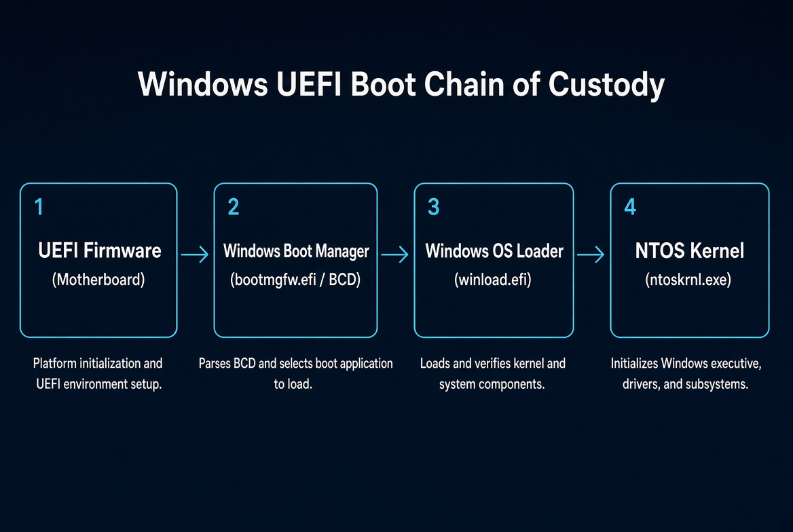

The boot process operates through four phases.

- Firmware Initialization: On power-on the UEFI firmware initializes the hardware it needs to read a disk, then reads the boot configuration stored in NVRAM to locate the designated device.
- Windows Boot Manager (`bootmgfw.efi`): The firmware searches the storage drive for the EFI System Partition and loads `bootmgfw.efi`. On installation media the same role is played by `efi/boot/bootx64.efi` and `efi/microsoft/boot/cdboot.efi`.
- Boot Configuration Data (BCD): The Boot Manager reads the BCD store, the database that replaced `boot.ini`. The BCD is a registry hive of GUIDs that name the Windows installation and any test or integrity flags.
- Windows OS Loader (`winload.efi`): If the boot is not a resume from hibernation through `winresume.efi`, the Boot Manager calls `winload.efi`. That loader brings in the boot-start drivers required to see the system volume and hands execution to `ntoskrnl.exe`.

`LowLevelBootTools.exe --list-boot` is the live view of that second phase: the ESP directory that holds `bootmgfw.efi` and the BCD, opened through `\\?\GLOBALROOT\SystemPartition\` because Windows does not assign the volume a drive letter. `--parse-boot-file` is the signature check on the file the firmware is about to load. `--extract-bcd` plus `--inspect-bcd` is the offline read of the hive the Boot Manager will consult.

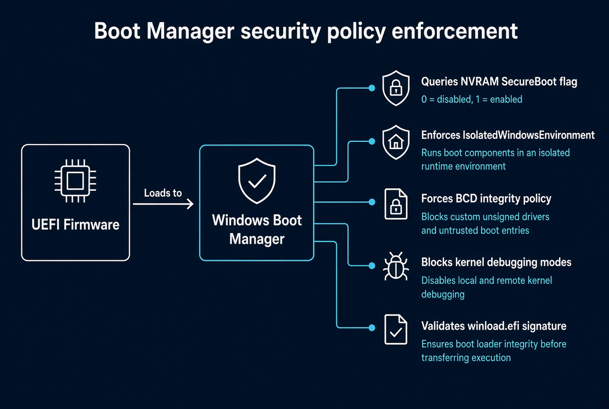

As soon as the Boot Manager has control it queries firmware variables before it honors BCD flags. `SecureBoot` (GUID `8BE4DF61-93CA-11D2-AA0D-00E098032B8C`) is a one-byte flag: `1` means image verification is active, `0` means it is off. `SetupMode` says whether NVRAM is still open. If Secure Boot is on, the Boot Manager forces the integrity policy: custom unsigned drivers stay blocked, kernel debugging flags in the BCD do not override the firmware, and `winload.efi` is validated before the handoff. `--modify-timeout` edits a copy of the hive for timeout experiments. It is not a live firmware write, and it does not clear those integrity flags.

## Disk & Partition Architecture

Windows divides a modern installation disk into three partitions.

| Partition | Typical size | File system | Internal purpose |
| --- | --- | --- | --- |
| EFI System Partition (ESP) | 100–300 MB | FAT32 | Firmware-readable UEFI binaries (`bootmgfw.efi`) and the BCD store |
| Microsoft Reserved (MSR) | 16–128 MB | none (raw) | Reserved for partition overhead and basic-to-dynamic conversion |
| Windows OS (`C:`) | remainder | NTFS | System files, application data, user profiles, registry hives |

The storage stack under the drive letter is three drivers deep. `disk.sys` talks SCSI or NVMe to the physical disk. `volmgr.sys` assembles partitions into volumes. `ntfs.sys` turns clusters into names, metadata, and security descriptors.

NTFS treats every object, including directories and the table itself, as a file. The Master File Table (`$MFT`) is the index. Each file has at least one 1,024-byte record. A very small file can live inside that record (resident). A larger file is a set of data runs pointed at by the record (non-resident). `$LogFile` is the journal written before a metadata change, so a power loss can roll forward or back. `$Bitmap` is the free-cluster map. Security descriptors are centralized so they are not copied into every record. Directory indexes are B-trees.

Standard paths cannot open `C:\$MFT`. Windows blocks that name. `DumpNtfsVolume.exe --volume \\.\C:` opens the volume object instead, with `FILE_SHARE_READ | FILE_SHARE_WRITE`, issues `FSCTL_GET_NTFS_VOLUME_DATA`, and reads at `MftStartLcn` times the cluster size. The first bytes of a real record are `FILE` (`46 49 4C 45`).

The boot files Secure Boot checks are not on `C:`. They sit on the ESP. `LowLevelBootTools.exe` uses `\\?\GLOBALROOT\SystemPartition\` for that volume. Changing the inner path from `bootmgfw.efi` to `EFI\Microsoft\Boot\BCD` extracts the live hive with the same open.

## Key Technologies in This Suite

These structures sit under every path in the lab. The diagrams below show where each one lives and which tool in the suite touches it.

### EFI System Partition (ESP)

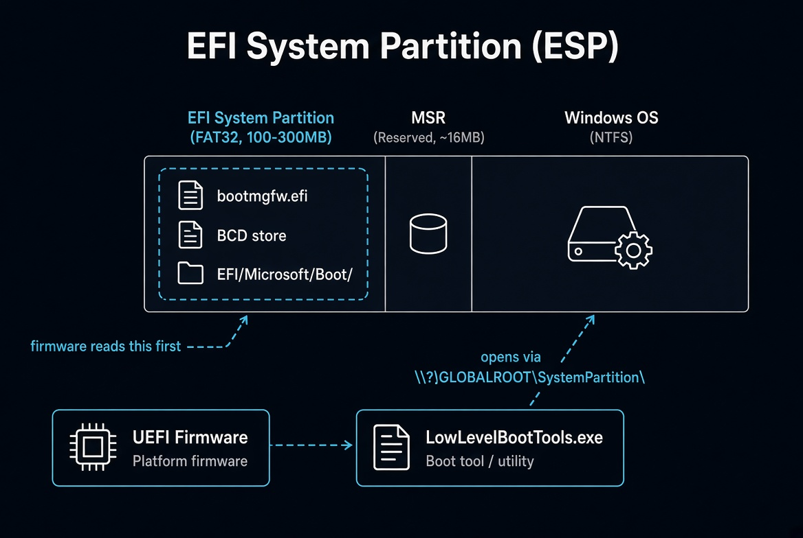

The ESP is the small FAT32 partition the firmware can read before any operating system starts. It holds `bootmgfw.efi`, the BCD store, and the `EFI/Microsoft/Boot/` tree. The firmware searches this partition for the Boot Manager; that is the second phase of the boot chain. Windows does not assign the ESP a drive letter. `LowLevelBootTools.exe --list-boot` and `--list-root` open it through `\\?\GLOBALROOT\SystemPartition\`. `--extract-boot` copies `bootmgfw.efi` out. `--extract-bcd` copies the hive the Boot Manager will consult. Everything that is a file the firmware loads lives here. Everything that is a firmware variable lives in NVRAM, not on the ESP.

### Virtualization-Based Security (VBS)

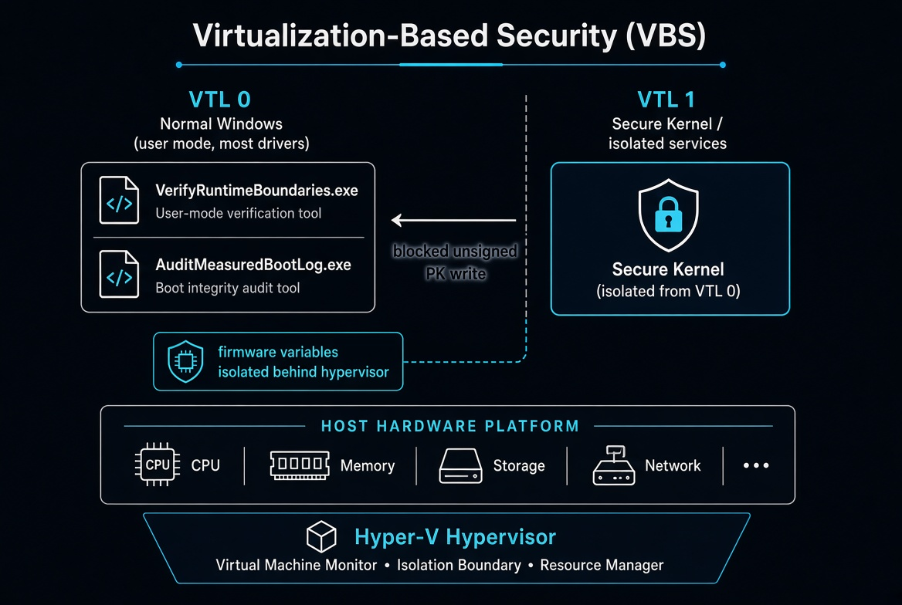

VBS is the Windows feature that puts the firmware variables behind a hypervisor wall. When it is on, Hyper-V runs under the Windows you see. Code Integrity, Credential Guard, and the firmware-variable service sit in Virtual Trust Level 1. Normal processes run in VTL 0. `VerifyRuntimeBoundaries.exe` runs in VTL 0. It can hold `SeSystemEnvironmentPrivilege` and it can ask to write `PK`. On a VBS boot the hypervisor has removed the physical addresses of the firmware variables from VTL 0, so the unsigned write is dropped. The tool sees access denied even though it is elevated. That is the containment the suite is built to demonstrate.

### Hypervisor-protected Code Integrity (HVCI)

HVCI is the part of VBS that enforces write-xor-execute on kernel pages. A page that is executable cannot also be writable. The hypervisor, not the kernel, owns that rule. A driver that tries to write a code page is stopped at the extended page table boundary. The suite does not inject drivers. The existing diagram below covers this wall; the new VBS diagram above is the separate wall around firmware variables. They are not the same wall.

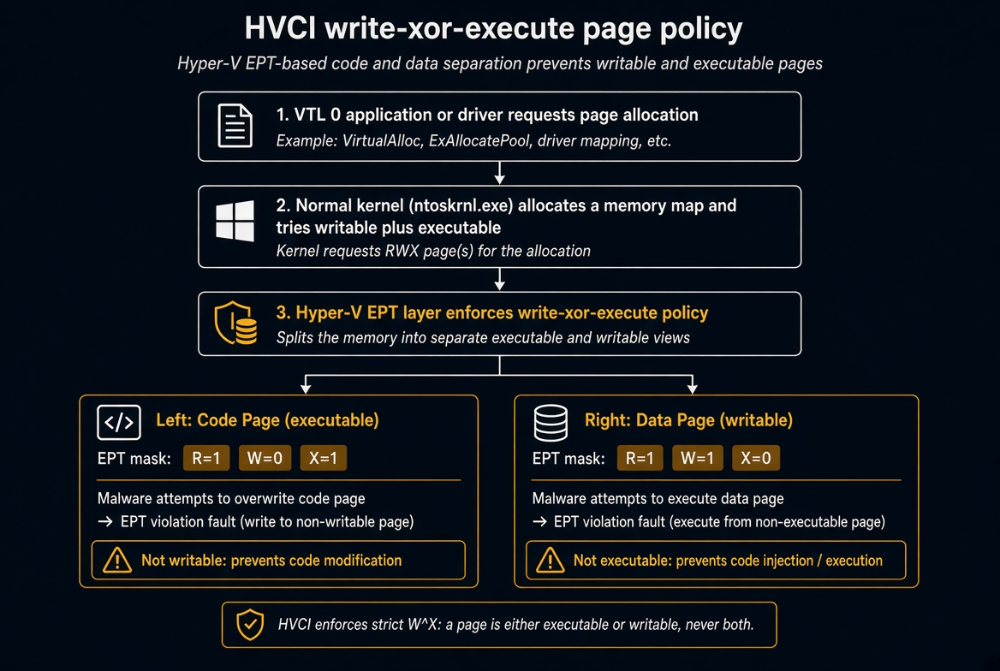

### Windows Preinstallation Environment (WinPE)

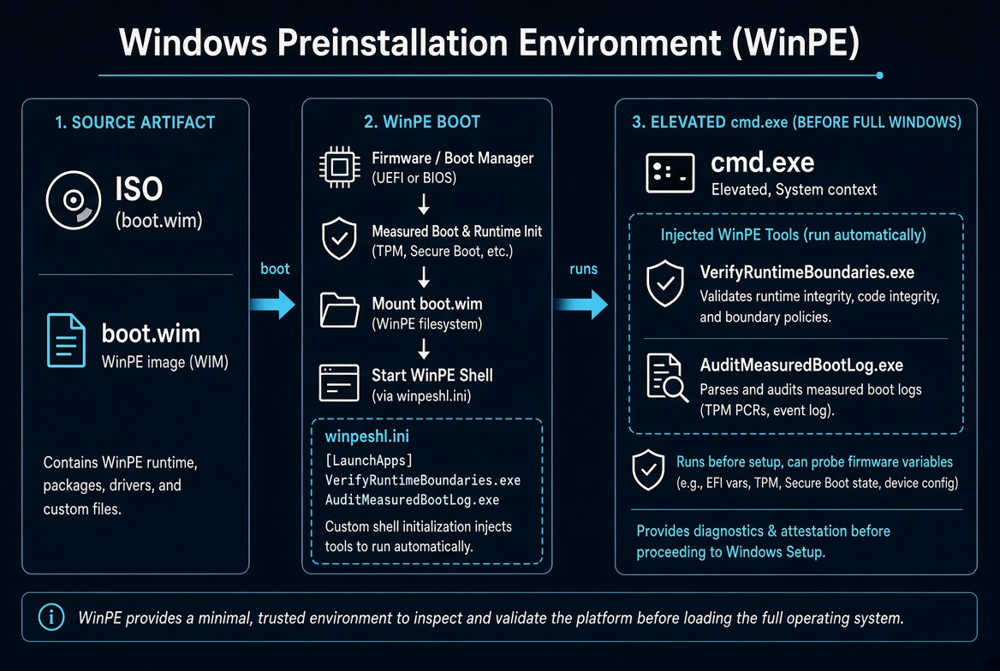

WinPE is the small Windows that boots from installation media before a full operating system is installed. `13_patch_winpe_image.sh` mounts `boot.wim`, copies `VerifyRuntimeBoundaries.exe` and `AuditMeasuredBootLog.exe` into `System32`, and applies `winpeshl.ini` so those tools run before setup. The point is an elevated command environment that can still see firmware variables, before any files are committed to the main partition. WinPE has no TPM of its own in a plain QEMU boot, so `AuditMeasuredBootLog.exe` records `0x8028400f` there. That is expected. The tools still run, and the absence of a TPM is itself the result.

### Secure Boot Databases

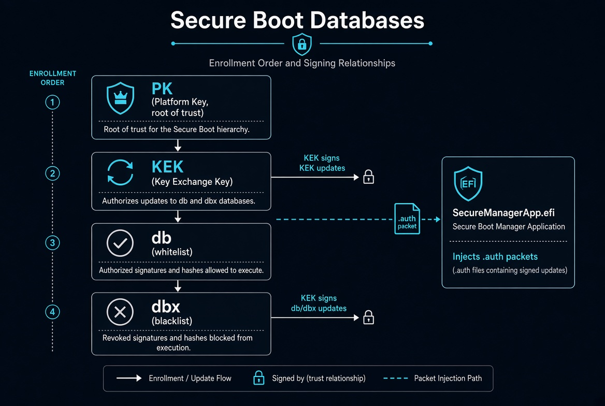

The four databases are the policy. `PK` is the Platform Key, the root of trust. `KEK` is the Key Exchange Key; updates to `db` and `dbx` must be signed by a key in `KEK`. `db` is the whitelist: a file whose hash or signing certificate is in `db` (and not in `dbx`) is allowed. `dbx` is the blacklist. `SecureManagerApp.efi` injects signed `.auth` packets that update these variables. The host scripts (`01_setup_certs.sh`, `03_generate_auth_update.sh`, `09_sign_db_with_kek.sh`) build those packets. The enrollment order is PK, then KEK, then db and dbx. A packet signed by the wrong key is rejected. `dbt` is the timestamp counter that rejects a replay of an older packet.

### Measured Boot and the TPM

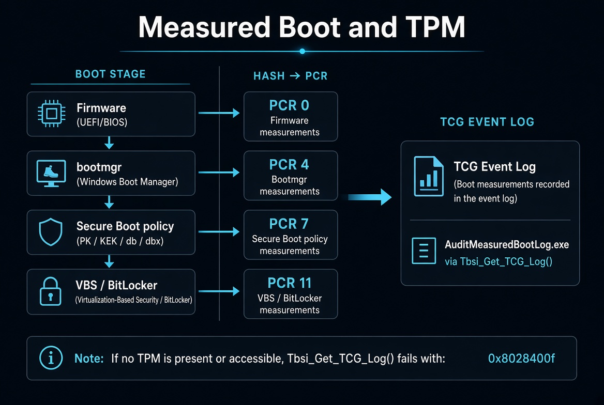

Measured Boot is the record of what ran. Each stage hashes the next one and extends a PCR in the TPM. PCR 0 is the firmware. PCR 4 is the bootloader. PCR 7 is the Secure Boot policy (`PK`, `KEK`, `db`, `dbx`) as it stood at boot. PCR 11 is VBS and BitLocker. The event log is the list of those extensions. `AuditMeasuredBootLog.exe` opens TPM Base Services and copies that log. `0x8028400f` means no TPM is visible. That is expected in WinPE and in QEMU without a software TPM. The call itself is the test. A matching pair with `VerifyRuntimeBoundaries.exe` is useful: one shows whether an unsigned write is blocked now, the other shows whether the policy that was active at boot was measured into PCR 7.

### QEMU, OVMF, and the Mutable NVRAM Store

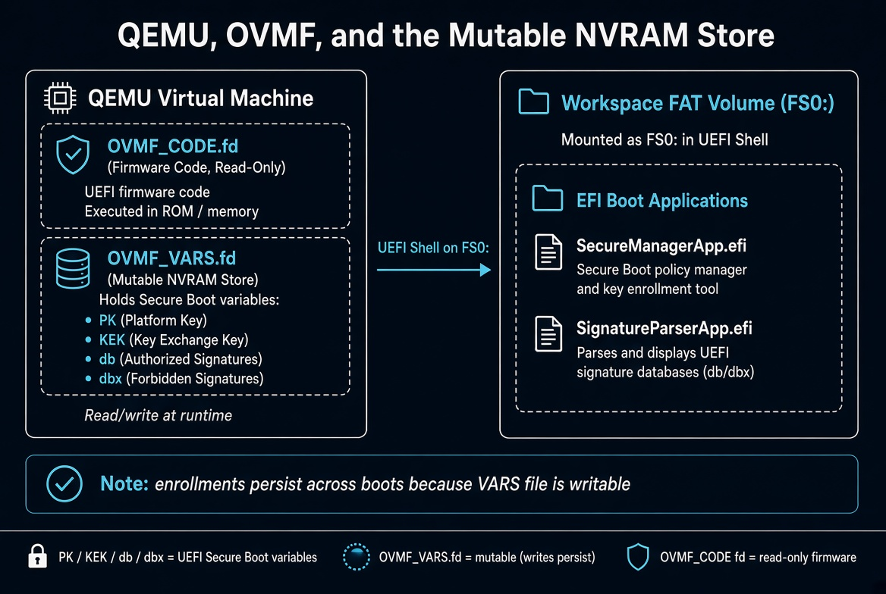

The lab does not run on bare metal. It runs inside QEMU with OVMF as the firmware. OVMF is used as a whole CODE+VARS pair, never mixed across the 4M and 2M families. `02_run_qemu.sh` and `12_run_patched_iso_qemu.sh` source `scripts/qemu_common.sh`, which prefers `OVMF_CODE_4M.secboot.fd` with `OVMF_VARS_4M.ms.fd` (or `OVMF_VARS_4M.fd` when `--empty-keys` / `--own-pk` is set), then a plain 4M pair, then 2M secboot/CODE+VARS. Images are searched in `/usr/share/OVMF`, `/usr/share/edk2/ovmf`, `/usr/share/qemu`, `/usr/share/ovmf`, and the repository root. The live copies are `workspace/ovmf/CODE.fd` (read-only firmware) and `workspace/ovmf/VARS.fd` (the variable store: PK, KEK, db, dbx, dbt, the Secure Boot mode bit, and the boot order). Compatibility copies are also written to `./OVMF_CODE.fd` and `./OVMF_VARS.fd` at the repo root.

Mutable means `workspace/ovmf/VARS.fd` can be written, and those writes survive the next boot. When `SecureManagerApp.efi` enrolls a key or injects an `.auth` packet, the firmware writes the new variable into that file. The next launch reuses it. A source CODE hash is stamped beside the pair; if the CODE image changes, the runner aborts rather than mixing a new firmware with an old store, unless you pass `--reset-vars` (which recopies the VARS template and drops enrollments). `12_run_patched_iso_qemu.sh` stages the same pair itself. If `workspace/ovmf/VARS.fd` is missing and a previous run left `./OVMF_VARS.fd` at the repo root, that enrollment is migrated when the family still matches.

On `02_run_qemu.sh`, the workspace directory is mapped as a FAT volume. In the UEFI shell it appears as `FS0:`. `SecureManagerApp.efi` and `SignatureParserApp.efi` live there. You start them from the shell after the firmware has already loaded. They read and write the variables that sit in the mutable VARS store. The host scripts build the `.esl` and `.auth` files that those apps consume. The apps are the only place the lab enrolls or inspects the policy from inside the firmware environment.

```
host
  workspace/ovmf/CODE.fd   (read-only firmware)
  workspace/ovmf/VARS.fd   (mutable NVRAM: PK, KEK, db, dbx, dbt)
  workspace/               (FAT, appears as FS0: on the 02 runner)
        |
        v
QEMU + OVMF
        |
        +--> UEFI Shell on FS0:
                 |
                 +--> SecureManagerApp.efi   (enroll / inject .auth)
                 +--> SignatureParserApp.efi (parse ESL / signature)
```

The Win32 tools never see this guest. They run later, on a Windows or WinPE boot that may or may not have VBS. The QEMU path is the controlled place where the policy is built and enrolled. The Win32 path is the place where the result of that policy is read back.

## QEMU lab features

`02_run_qemu.sh` and `12_run_patched_iso_qemu.sh` share the flags below. Every launch prints a feature table (`feature`, `state` = on / off / skipped, and a reason) and, with `--dry-run`, the full QEMU and swtpm command lines without starting either process. Only documented OVMF `fw_cfg` names from EDK2 `OvmfPkg/RUNTIME_CONFIG.md` are hard-wired; unknown names are not invented.

| Flag | Default | What it does | Notes |
| --- | --- | --- | --- |
| `--tpm` / `--no-tpm` | on | swtpm TPM 2.0, QEMU `tpm-crb` | State is `workspace/tpm/<vm>/`. `02` uses `shell`, `12` uses `windows`. An EXIT trap stops the daemon and leaves the state dir in place. EK/platform certificates are authored when `swtpm_localca` is usable; otherwise setup retries without certificates. PCR measurements still work. |
| `--tpm-tis` | off | Use `tpm-tis` instead of `tpm-crb` |  |
| `--smm` / `--no-smm` | on | `-machine q35,smm=on` and `cfi.pflash01,secure=on` | Machine options are merged into a single `-machine` argument. CODE is pflash unit 0 readonly; VARS is unit 1 writable. |
| `--vbs auto\|on\|off` | auto | KVM + nested Hyper-V enlightenments | auto turns them on only when `/dev/kvm` is readable and `kvm_intel`/`kvm_amd` nested is `Y` or `1`. CPU is `host,+vmx` or `host,+svm` with `hv-passthrough` when QEMU accepts that property, otherwise the explicit set `hv-relaxed,hv-vapic,hv-spinlocks=0x1fff,hv-vpindex,hv-runtime,hv-synic,hv-stimer,hv-time,hv-frequencies,hv-tlbflush,hv-ipi`. KVM is enabled only when a short QMP probe against a tiny `-accel kvm` VM succeeds. `/dev/kvm` can be present but unusable; in that case the runner falls back to TCG (`-cpu max`) and VBS/IOMMU are skipped. |
| `--nested` (`02` only) | off | Force `--vbs on` and default 4096 MiB / 4 vCPUs | A later `--memory` / `--smp` still overrides the shape. Historical name: `qemu_nested.sh`. |
| `--no-nested` (`12` only) | off | Force `--vbs off` |  |
| `--iommu` | off | Intel IOMMU + `kernel-irqchip=split` | Only with KVM: `-device intel-iommu,intremap=on,caching-mode=on`. Without KVM the feature is skipped. |
| `--fw-protections` | off | Two documented fw_cfg knobs | `opt/ovmf/PcdSetNxForStack,string=yes` and `opt/org.tianocore/EnableLegacyLoader,string=no`. `UninstallMemAttrProtocol` is not turned on. |
| `--fw-cfg SPEC` | none | Pass-through `-fw_cfg SPEC` | Repeatable. `SPEC` is `name=...,string=...` or `name=...,file=...`. |
| `--smbios-profile FILE` | none | Lines become `-smbios` arguments | `profiles/smbios_lab.conf` is a type 0/1/2/3 example. Blank lines and `#` comments are ignored. |
| `--acpitable FILE` | none | `-acpitable file=FILE` | Repeatable pass-through. |
| `--debugcon [PATH]` | off | isa-debugcon at I/O `0x402` | Default path: `workspace/logs/ovmf_debug.log`. Debian release OVMF often writes nothing here; an empty file is not evidence of a failed boot. |
| `--gdb` / `--gdb-port PORT` | off | Wait for gdb (`-S`) | `--gdb` uses TCP 1234. |
| `--nographic` | off | `-display none` | Use `--serial-log PATH` in tests; otherwise serial is `mon:stdio`. `12` also drops the HDA audio device in this mode. |
| `--serial-log PATH` | off | Guest serial to a file |  |
| `--qmp PATH` / `--monitor PATH` | off | QMP or HMP unix socket | `server,nowait`. |
| `--reset-vars` | off | Recopy the VARS template | Drops enrollments. |
| `--empty-keys` / `--own-pk` | off | Empty VARS template (Setup Mode) | Uses `OVMF_VARS_4M.fd` (or the 2M empty template) instead of the `.ms` keys. Switching templates with an existing store requires `--reset-vars`. |
| `--sev` / `--tdx` | off | Experimental, conservative | Enabled only in the feature table when a host device or module is present, and refused when mixed with SMM. This lab does **not** emit an untested `-object sev-guest` / TDX machine line. Treat both as skipped unless you have added and tested a host-specific command yourself. |
| `--dry-run` | off | Print table + command, do not launch | `12` also allows a missing ISO in this mode so the command line can be inspected. |

Shared implementation lives in `scripts/qemu_common.sh`. Existing runner arguments are unchanged: `02` still accepts `--nested`, `--memory`, `--smp`; `12` still accepts `[patched.iso]`, `--no-nested`, `--memory`, `--smp`, `--disk`.

**What the automated tests cover.** `tests/run_tests.sh` (pytest) checks Auth2 packet layout, ISO/WinPE idempotency, dry-run command shape for the flag combinations above, OVMF CODE/VARS mismatch abort, and, when `qemu-system-x86_64`, swtpm, and OVMF are installed, a headless `02` boot with SMM, swtpm, serial, debugcon, and QMP. That live boot asserts QEMU `query-tpm`, OVMF/UEFI evidence in the captured logs, and swtpm cleanup after exit. PCR readout after a TCG or KVM boot is attempted with `tpm2_pcrread` against the saved swtpm state; if those PCRs come back all-zero because of a `startup-clear` reopen, the test skips the PCR assertion rather than inventing measured-boot evidence. KVM, IOMMU, and VBS live paths require a readable `/dev/kvm` and nested virtualization; they are skipped with a reason when those are missing. SEV/TDX boots are not performed.

**Not implemented, or intentionally untouched.** El Torito on `11_extract_and_patch_iso.sh` still uses `efi/boot/bootx64.efi` as the EFI boot image; the Isolinux-size warning on tiny fixture ISOs is tolerated when the output ISO was written (see the TODO in that script). This tree does not invent additional OVMF `fw_cfg` names beyond the two listed under `--fw-protections` plus explicit `--fw-cfg` pass-through.

## Signature Lists, Keys, and What Each Tool Is Reading

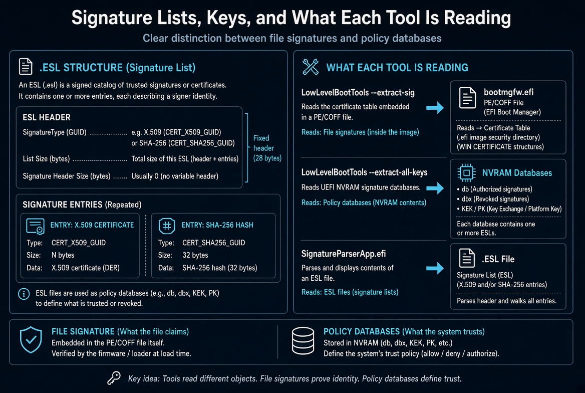

An `.esl` file is not a renamed certificate. It is an EFI Signature List: a 16-byte SignatureType GUID, a list size, a header size, a signature size, then entries. An X.509 entry is a 16-byte owner GUID plus the DER certificate. A SHA-256 entry is a 16-byte owner GUID plus 32 hash bytes. The SHA-256 type GUID used by the generators is `{c1c41626-504c-4092-aca9-41f936934328}`.

| Variable | Role |
| --- | --- |
| `PK` | Platform owner. Writing it leaves Setup Mode. |
| `KEK` | Key Exchange Key. Signs updates to `db` and `dbx`. |
| `db` | Whitelist of certificates and hashes allowed to execute. |
| `dbx` | Blacklist. A hit here blocks execution even if `db` would have allowed it. |
| `dbt` | Timestamp database. Anti-replay version matrix for `.auth` packets. |

`LowLevelBootTools.exe --extract-sig` reads the certificate table inside `bootmgfw.efi`. That is who signed the file. `--extract-all-keys` reads the NVRAM databases the firmware compares that signature against. That is who is allowed to have signed a file. A `.p7b` and a `db.esl` are different objects. `SignatureParserApp.efi` and `--parse-esl` both walk the list, including every revoked hash in `dbx`. They do not collapse the list to a sample.

`04_extract_ms_certs.sh` detaches the vendor table. `07_extract_certs_to_esl.sh` turns that public certificate into an `.esl` that Option 1 can enroll, so a lab can still execute the original Microsoft-signed loader beside a loader signed by the local `db`. `16_verify_signatures.sh p7b` prints the same certificate on the host before it is copied into the QEMU workspace.

User mode cannot dump a full SPI image of the host firmware. `GetSystemFirmwareTable('RSMB')` returns the SMBIOS inventory the firmware published, not the firmware volume that contains the Secure Boot driver. `--dump-smbios` is that raw table. `ParseSmBios.exe --parse-smbios` is the typed read of Type 0 and Type 1. A full firmware-volume dump needs a kernel driver or a programmer, and this suite does not ship one.

## Enrollment Order

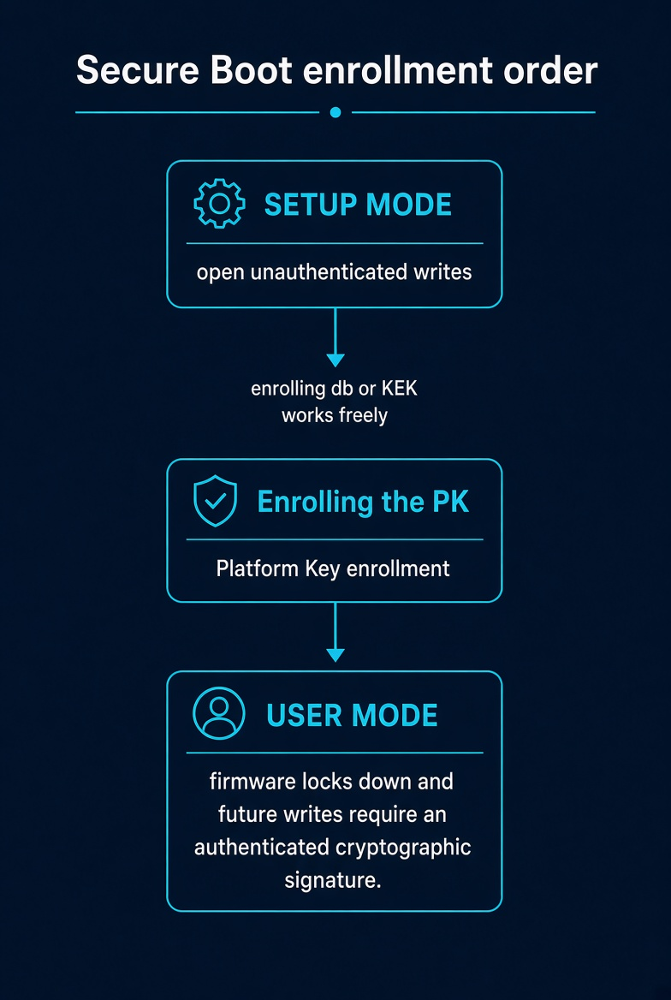

Setup Mode accepts unauthenticated writes. Enrolling `db` or `KEK` succeeds natively. Enrolling `PK` locks the interface and transitions the firmware to User Mode. From that point a database edit requires a signed `.auth` packet.

If `PK` is enrolled first, the gate shuts immediately. A later `setvar` of the custom `db` certificate is rejected with `EFI_SECURITY_VIOLATION` or `EFI_WRITE_PROTECTED`. Enroll `db`, then `KEK`, then `PK`. `SecureManagerApp.efi` Option 1 is that sequence: scroll to the `.esl`, then choose `D`, `K`, or `P`.

After lockdown, Option 2 is the only write path. `09_sign_db_with_kek.sh` wraps an existing `.esl` with the KEK. `03_generate_auth_update.sh` wraps a fingerprint or a binary hash, and it can move the timestamp. `db` and `dbx` are signed by the KEK. `PK` and `KEK` are signed by the PK. The attribute mask on those packets is `0x00000027`: non-volatile, boot-service, runtime, and time-based authenticated write.

Option 4 is the emergency wipe: data size 0 on `dbx`, `db`, `KEK`, then `PK`. In User Mode the `PK` delete is rejected unless it arrives as a signed update. The reliable lab reset is replacing `OVMF_VARS.fd` with a fresh OVMF template.

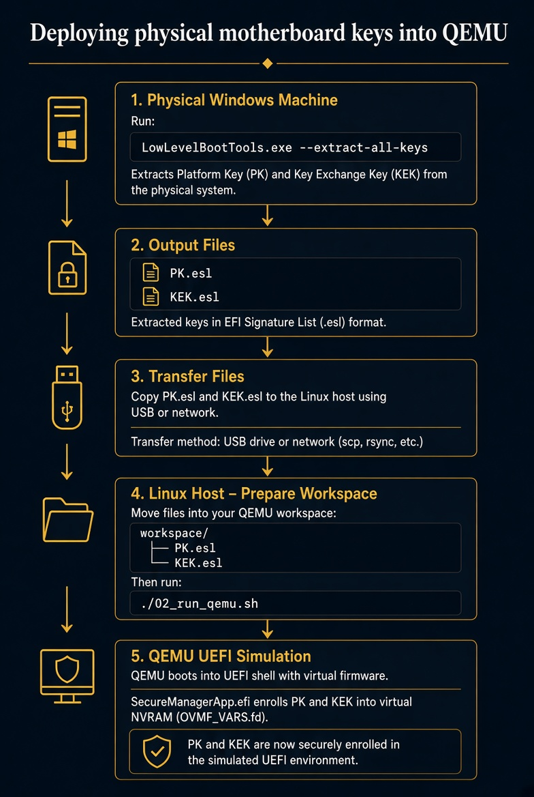

A physical machine's keys can be replayed into the virtual NVRAM. On the Windows host, elevated, `LowLevelBootTools.exe --extract-all-keys` writes `PK.esl` and `KEK.esl`. Those files move into `workspace/` on the Linux host. `02_run_qemu.sh` exposes that directory as `FS0:`. `SecureManagerApp.efi` Option 1 enrolls them into `OVMF_VARS.fd`. The virtual machine then verifies images against the same trust anchors as the physical board, without writing those anchors back to the physical board.

## Image Loader Gates, Signing, and the Patched Media

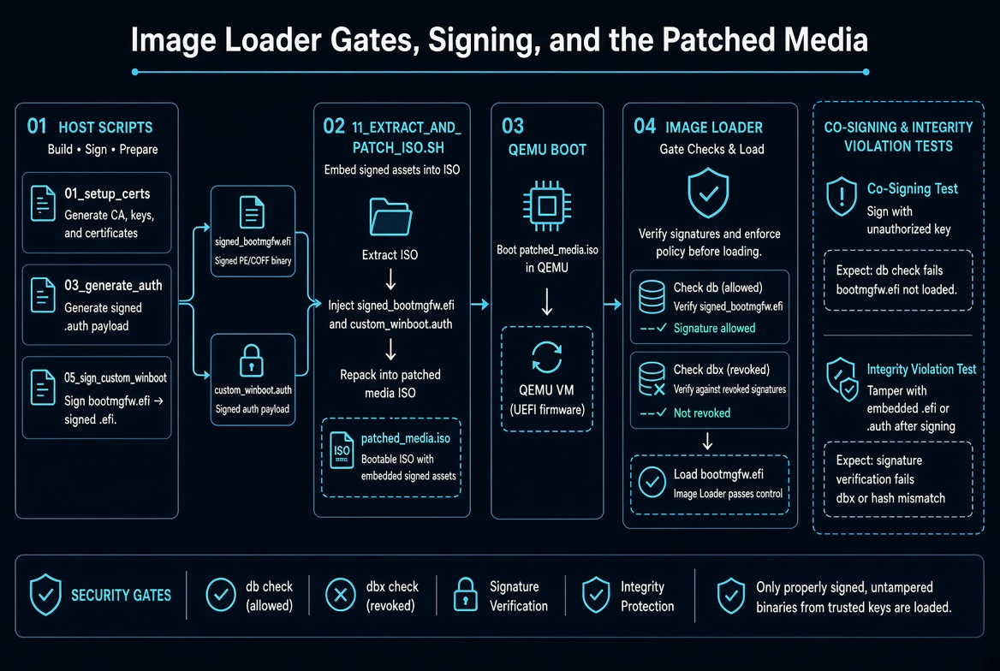

`SignatureParserApp.efi` prints the enforcement order before it parses a file. Gate 1 hashes the image and blocks on a `dbx` hit. Gate 2 walks the certificate table and blocks on a revoked signer. Gate 3 allows the image only if a hash or signer is in `db`. Otherwise the load stops.

`05_sign_custom_winboot.sh` strips the vendor trailer from a copy and seals it with the lab `db` key. `08_cosign_application.sh` appends a second signer (`Secondary Independent Co-Signer Authority`) without removing the first. `sbverify --list` on `winboot_cosigned.efi` should show both. Revoking one signer does not silently revoke the other, which is why co-signing is a gate test and not a cosmetic second signature.

`11_extract_and_patch_iso.sh` replaces `efi/boot/bootx64.efi` and `efi/microsoft/boot/cdboot.efi` with the signed loader and drops `autounattend.xml` on the media root. Volume id is `VAULT_LAB`. `13_patch_winpe_image.sh` then mounts `boot.wim` index 2, which is the Setup WinPE image rather than the small recovery image in index 1, and commits `winpeshl.ini` plus the diagnostics. `12_run_patched_iso_qemu.sh` boots that ISO on a 64 GB qcow2 disk, reusing the `OVMF_VARS.fd` produced by step 02 so the enrolled keys are the ones the media is verified against.

`10_simulate_integrity_violation.sh` copies a valid `.auth` and writes `DE AD BE EF` one hundred bytes from the end. Length stays the same. Option 2 must fail PKCS#7 verification. A TPM-backed boot can record that class of failure against PCR 7. `AuditMeasuredBootLog.exe` is the reader for that log once Windows or WinPE is up. QEMU without a software TPM fails the TBS open, and the tool prints that failure.

## Virtualization-Based Security

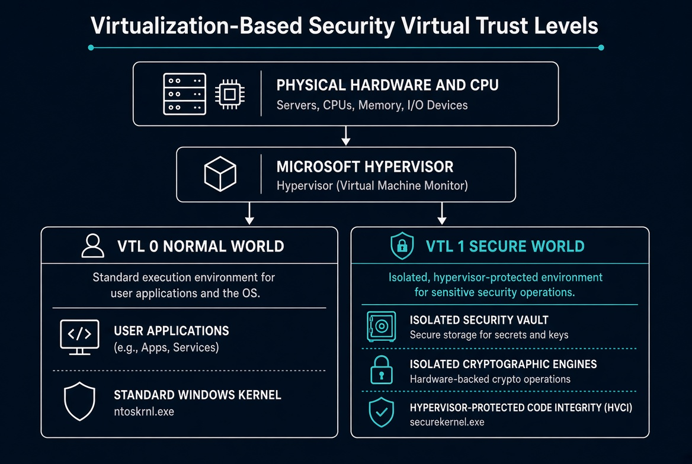

VBS uses the hypervisor to split physical memory into Virtual Trust Levels. VTL 0 is the normal world: user applications and `ntoskrnl.exe`. VTL 1 is the secure world: the isolated vault, the cryptographic engines, and Hypervisor-Protected Code Integrity in `securekernel.exe`. A traditional Ring 0 kernel is not the top of this stack.

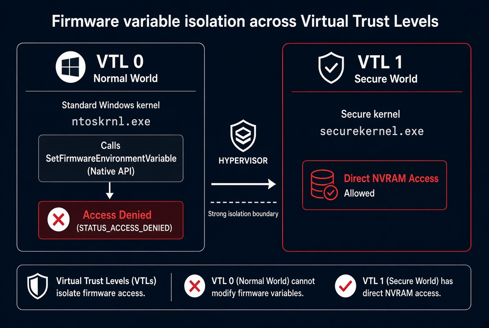

When a VTL 0 process calls `SetFirmwareEnvironmentVariableW`, the request enters `ntoskrnl.exe`. The hypervisor has omitted the firmware MMIO from the VTL 0 extended page tables, so the call is trapped. Control moves to VTL 1. `securekernel.exe` checks whether the update carries an authenticated envelope. Only then does VTL 1 touch NVRAM, and only a status returns to VTL 0. `VerifyRuntimeBoundaries.exe` is that call, made from user mode, with the privilege enabled and the envelope omitted.

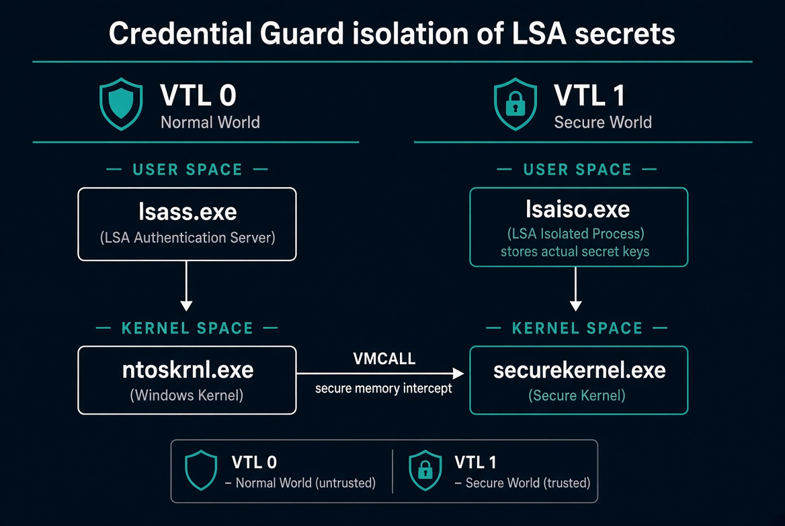

Credential Guard uses the same split for secrets. `lsaiso.exe` in VTL 1 holds the derived credentials. `lsass.exe` in VTL 0 becomes a proxy. An authentication request goes from `lsass.exe` to `ntoskrnl.exe`, across a `VMCALL`, into `securekernel.exe`, and only a validation token comes back. A memory dump of `lsass.exe` does not contain the secrets. A dump aimed at `lsaiso.exe` fails because VTL 0 cannot map VTL 1 pages. This suite does not attach to `lsaiso.exe`. It boots the guest whose enlightenment bits make that process possible, and it instruments the firmware-variable boundary.

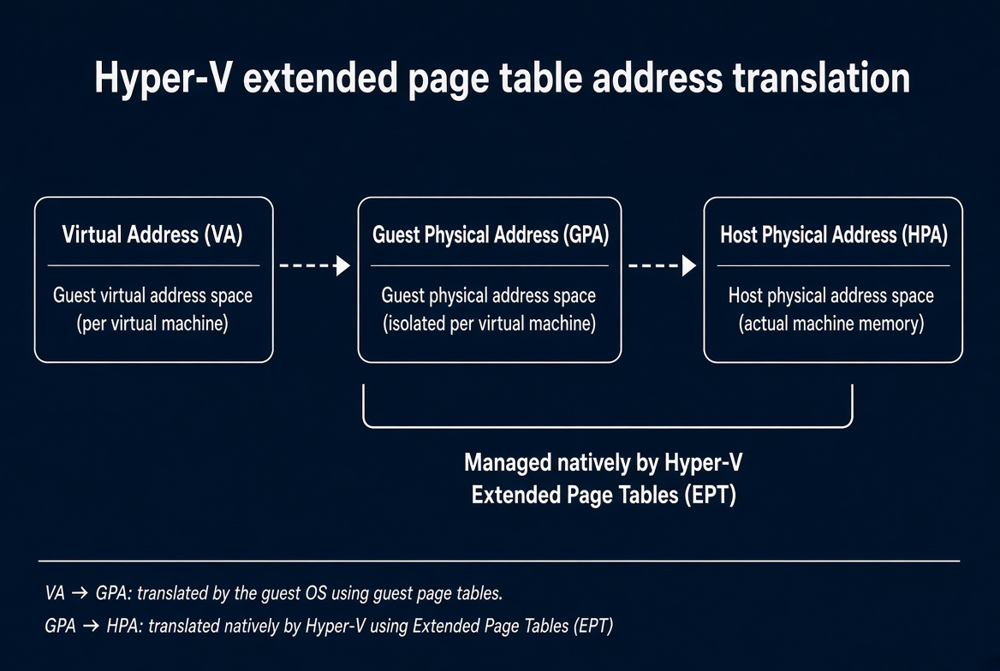

Guest virtual addresses become guest physical addresses in the guest page tables. Guest physical addresses become host physical addresses in the Hyper-V extended page tables. The EPT entry is also a permission mask: read, write, execute, and user/supervisor. Those bits are the hypervisor's, not the guest kernel's.


HVCI applies W^X. A page may be writable or executable, not both. Code pages are mapped `R=1, W=0, X=1`. A write from a compromised VTL 0 kernel raises an EPT violation. Data pages are mapped `R=1, W=1, X=0`. An attempt to execute injected bytes raises an EPT violation. A legitimate code update cannot flip its own mapping. VTL 0 hands the pages to the code-integrity component in VTL 1. VTL 1 checks the Authenticode signature. Only then does the secure kernel authorize Hyper-V to update the EPT flags.

Nothing in `win32/` programs those bits. The observation this repository supports is the user-mode result on the firmware-variable boundary, and the measured-boot log beside it.


## What the Win32 tools are actually touching

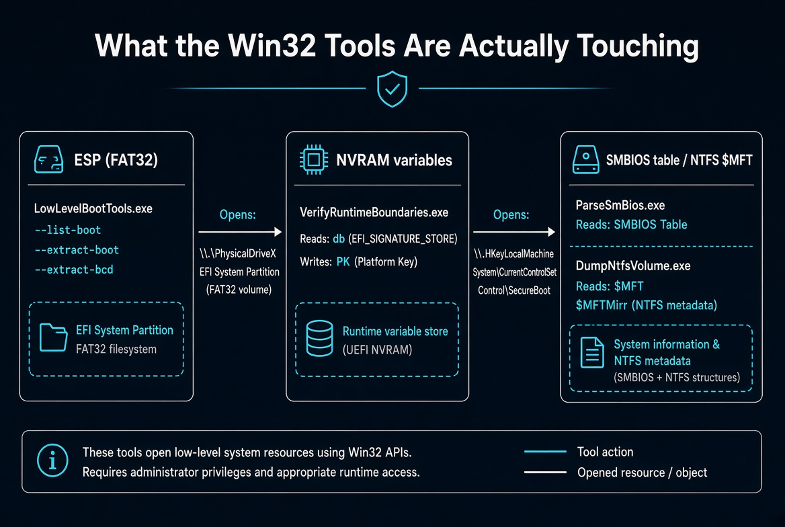

The firmware shell and the Windows diagnostics are not two copies of the same reader. `SecureManagerApp.efi` writes variables through UEFI runtime services, before `ntoskrnl.exe` exists. The Win32 tools run after that handoff, and each one is aimed at a different object.

`LowLevelBootTools.exe --list-root` and `--list-boot` open the ESP. That is the FAT32 volume the firmware searched for `bootmgfw.efi`. `--extract-boot` copies that image out. `--extract-sig` splits the Authenticode certificate table from the PE security directory. The security directory's virtual address is a file offset, not a memory RVA, which is why a normal PE parser mis-reads it. `--parse-boot-file` prints the machine field and the section count, then calls `WinVerifyTrust`. The standalone `WinVerifyTrust.exe` does only that last call, on whatever path is passed as its single argument, so a lab can separate "the ESP open failed" from "the signature is not trusted."

`--extract-bcd` copies `EFI\Microsoft\Boot\BCD`. `--inspect-bcd` loads `offreg.dll` and enumerates the object GUID names without mounting the hive into the live registry. `--modify-timeout` writes a timeout DWORD onto a sibling hive. The Boot Manager will still ignore a BCD flag that contradicts an active Secure Boot policy, which is the point of the policy diagram above.

`--extract-all-keys` enables `SE_SYSTEM_ENVIRONMENT_NAME` and calls `GetFirmwareEnvironmentVariableW` for `PK`, `KEK`, `db`, `dbx`, and `dbt`. `--parse-esl` walks list size, signature size, type GUID, and SHA-256 payloads. `--esl-to-cer` takes the first entry past the 44-byte header and writes DER, after a `CryptDecodeObject` attempt. If `db` comes back empty from the Win32 call and full from `SignatureParserApp.efi`, the usual cause is the variable GUID: `PK` and `KEK` live under `EFI_GLOBAL_VARIABLE`, while `db` and `dbx` live under the image-security database GUID. The firmware application queries the database GUID directly.

`DumpNtfsVolume.exe` never opens the ESP. It opens the NTFS volume, because `$MFT` is a file-system object, not a firmware object. `ParseSmBios.exe` never opens either volume. It reads the SMBIOS table the firmware published to the OS. Keeping those three apart is what makes a forensic pass interpretable.

## Authenticated packets, clocks, and the violation file

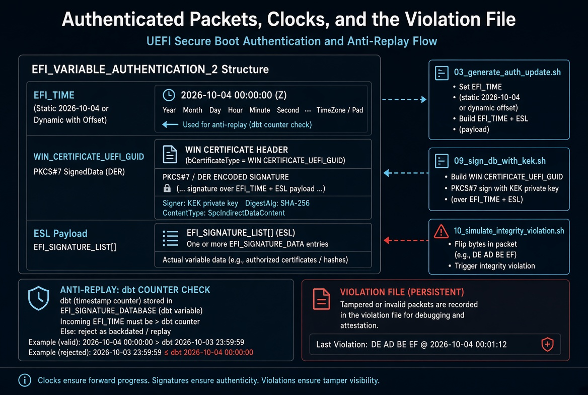

`03_generate_auth_update.sh` and `09_sign_db_with_kek.sh` build the same envelope shape. A 16-byte `EFI_TIME` prefix, a `WIN_CERTIFICATE_UEFI_GUID` header (length, revision `0x0200`, type `0x0EF1`, `EFI_CERT_TYPE_PKCS7_GUID`), a detached PKCS#7 SignedData, then the signature-list payload. The static laboratory clock is `2026-10-04 23:30:00` UTC, packed as the 16-byte `EFI_TIME` `EA 07 0A 04 17 1E 00 00` followed by eight zero bytes (Nanosecond, TimeZone, Daylight, Pad2). The first eight bytes are little-endian year, then month, day, hour, minute (`0x1E` = 30), second, and Pad1. Dynamic mode recomputes the full 16-byte `EFI_TIME` from the host clock in UTC, with the trailing fields still zero. A negative offset moves that clock backward. `SecureManagerApp.efi` reads the stored `dbt` entries back out as `YYYY-MM-DD HH:MM:SS GMT`. If the banner does not match the clock the script printed, the packet that landed is not the packet that was just generated. The signed bytes are VariableName (UTF-16LE, no NUL), VendorGuid, Attributes, that `EFI_TIME`, and the ESL. `PK` and `KEK` packets use the Global Variable GUID in mixed-endian form `61dfe48bca93d211aa0d00e098032b8c`.

The SHA-256 list header used for a single hash is fixed: type GUID `{c1c41626-504c-4092-aca9-41f936934328}`, list size 76, header size 0, signature size 48. Owner GUID bytes from `uuidgen` are field-swapped so the firmware's mixed-endian GUID matches the printed value. `cert-to-efi-sig-list -g` does that swap itself. A GUID handed to `-g` must not be swapped a second time.

`10_simulate_integrity_violation.sh` does not change the clock. It copies a valid packet and writes four bytes, `DE AD BE EF`, at `size - 100`, without truncating. Headers survive. The PKCS#7 body does not. Option 2 fails verification. A backdated packet fails the `dbt` compare instead. Those are different rejects, and the banner counter distinguishes them: a clock reject leaves the newer timestamp in place.

Option 3 is the Setup Mode blacklist path, not a substitute for an `.auth`. A certificate file is stored as a 16-byte owner GUID plus the file bytes, type `gEfiCertX509Guid`. A hash file is stored only when it is 32 bytes, as a 48-byte record, type `gEfiCertSha256Guid`. The existing `dbx` is read first and prefixed, so a new revocation does not erase the ones already stored. Under User Mode that raw append is rejected. The User Mode revocation is an `.auth` aimed at `dbx`.

## Media, WinPE, and the order of the long path

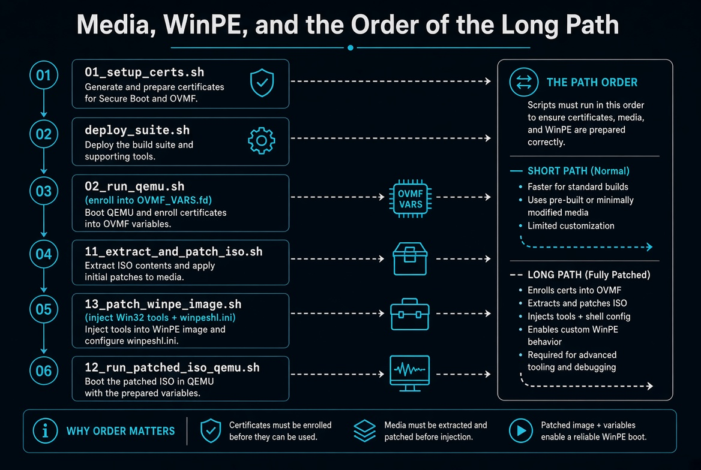

The short quick-start is the media path. The firmware-only path does not need an ISO. `01_setup_certs.sh`, `deploy_suite.sh`, and `02_run_qemu.sh` are enough to enroll `db`, then `KEK`, then `PK`, and to watch Option 2 accept a static packet and reject a backdated one. `OVMF_VARS.fd` is the virtual motherboard. Deleting it is the factory reset that does not require a signed PK update. Keep a copy before any enrollment that should be replayed.

The media path starts from a vanilla ISO so the vendor loader can be compared with the lab loader. `04_extract_ms_certs.sh` isolates `workspace/certs/extracted/ms_winboot_signature.p7b`. `16_verify_signatures.sh` prints that chain on the host. `05_sign_custom_winboot.sh` writes `winboot_signed.efi` without destroying `winboot.efi`. `08_cosign_application.sh` is optional and only meaningful if `sbverify --list` shows two trailers afterward.

`11_extract_and_patch_iso.sh` is the xorriso unpack, patch, and rebuild. It needs `xorriso`. The default `--all` path (extract + patch + rebuild) is for ISO-only work. The WinPE path is `--extract --patch`, then `13_patch_winpe_image.sh`, then `--rebuild`. The tree in `tmp_iso_extract/` is kept by default. `--keep-tree` is deprecated and ignored; `--clean` deletes the tree and `tmp_iso_state/`. Extract writes `.stamp_extract` (SHA-256 of the source ISO) and copies `sources/boot.wim` to `tmp_iso_state/boot.wim.orig`, which is never packed into the ISO. Patch writes `.stamp_patch_iso` from `autounattend.xml` and the signed loader. Matching stamps are skipped unless `--force` is passed. `--all` and `--extract` refuse to extract over a tree that has `.stamp_winpe` unless `--force`. The WinPE script mounts `sources/boot.wim` index 2, restores that original first so injections do not stack, copies `VerifyRuntimeBoundaries.exe`, `AuditMeasuredBootLog.exe` when it exists, and `winpeshl.ini` into `Windows\System32`, copies both `.efi` applications to the ISO root, and writes `.stamp_winpe`. `--rebuild` runs xorriso against the existing tree, which is what puts the injection inside the ISO that step 12 boots. `12_run_patched_iso_qemu.sh` stages OVMF itself under `workspace/ovmf/`; a prior `02_run_qemu.sh` run is no longer required.

`winpeshl.ini` uses the `LaunchApps` comma separator. `cmd.exe /k` keeps the diagnostic window open. `setup.exe` is last. Removing it leaves the lab at the diagnostics and never installs. Putting a diagnostic after `setup.exe` hides the result until setup returns, which is too late for a pre-install measurement.

Nested virtualization is a host property, not an ISO property. `/sys/module/kvm_intel/parameters/nested` or the AMD equivalent must be `Y` or `1`. Step 12 then advertises `hv_relaxed`, `hv_spinlocks=0x1fff`, `hv_vapic`, `hv_time`, `hv_stimer`, `hv_synic`, `hv_runtime`, and `hv_vpindex`. Those bits are what a Windows guest looks for before it starts the hypervisor that hosts VTL 1. They do not create a TPM. Measured-boot output still needs a TPM exposed to the guest. A missing TPM is printed by `AuditMeasuredBootLog.exe` and is not the same result as Secure Boot being off.

## Measured boot and the attestation report

`AuditMeasuredBootLog.exe` opens a TBS context with `TBS_CONTEXT_VERSION_TWO` and TPM 2.0 included, size-queries the log, then walks classic `TCG_PCR_EVENT` records. The report focuses on PCR 0 (firmware), PCR 4 (bootloader), PCR 7 (Secure Boot variables), and PCR 11 (BitLocker and VBS measurements). Event labels follow the TCG codes the sources defined: POST code, EFI application, boot driver, runtime driver, handoff tables, variable driver config, variable authority. The footer states whether a Secure Boot config event and a `db` / `dbx` authority event were present.

A crypto-agile log has a different header. If the walk stops immediately on a modern host, the classic header does not describe that log, and stopping is safer than reading off the buffer. The corruption drill in `10_simulate_integrity_violation.sh` and the PCR 7 lines in this report are the same event seen from two sides, when a TPM is actually attached.

## Files that are lab state

`workspace/` (including `workspace/ovmf/`, `workspace/tpm/`, and `workspace/logs/`), `OVMF_VARS.fd`, `OVMF_CODE.fd`, `tmp_iso_extract/`, `tmp_iso_state/`, `tmp_wim_mount/`, and the vanilla ISOs are generated state, not source. `workspace/ovmf/VARS.fd` (and the compatibility copy `OVMF_VARS.fd`) contains the Platform Key enrollment. `workspace/certs/*.key` is the ability to write that policy. `tmp_iso_state/boot.wim.orig` is the pristine WinPE image used to redo an injection. Neither belongs in a commit. `WinVerifyTrust.cpp` keeps the Microsoft sample copyright line. The rest of the tree is lab code for machines you administer.

## Per-Tool Reference

This section is a reference for every host script, the two UEFI applications, and every Win32 diagnostic. The earlier index remains the short form. Each entry below states the purpose, a typical use, what the tool reads, what it writes, and a small diagram of that flow.

### Host scripts

#### `00_download_windows_iso.sh`

Purpose: fetch a pristine evaluation ISO that the rest of the chain treats as the unmodified baseline.

Use cases: first run of the lab; replacing a corrupted media file; switching the experiment from Windows 10 to Windows 11.

```
./00_download_windows_iso.sh --win11 --url https://example.invalid/eval.iso
./00_download_windows_iso.sh --win10 --url https://example.invalid/eval.iso
```

```
  --win10 / --win11 / --url
            |
            v
  +---------------------------+
  | 00_download_windows_iso   |
  +---------------------------+
            |
            v
  windows10_vanilla.iso
  windows11_vanilla.iso
```

This script is a `curl -L` of the URL you pass. It does not call Microsoft REST endpoints. The built-in placeholder is `https://microsoft.com` and is not a usable ISO. `--url` is required for a live pull.

#### `01_setup_certs.sh`

Purpose: build the laboratory PK, KEK, and db signer, then wrap each public certificate in an EFI Signature List the firmware can enroll.

Use cases: a clean lab identity; regenerating keys after a wipe of `workspace/certs`.

```
./01_setup_certs.sh
```

```
  (no arguments)
        |
        v
  openssl + cert-to-efi-sig-list
        |
        +--> workspace/certs/PK.key   PK.crt    and workspace/PK.esl
        +--> workspace/certs/KEK.key  KEK.crt   and workspace/KEK.esl
        +--> workspace/certs/db.key   db.crt    and workspace/db.esl
```

Private keys stay on the host. Only the `.esl` and later `.auth` packets are meant to cross into the guest.

#### `02_run_qemu.sh`

Purpose: boot an OVMF shell with a mutable NVRAM store and the workspace FAT volume on `FS0:`.

Use cases: enroll keys with `SecureManagerApp.efi`; inspect packets with `SignatureParserApp.efi`; confirm a signed loader before the Windows ISO path.

```
./02_run_qemu.sh
./02_run_qemu.sh --nested --memory 4096 --smp 4
./02_run_qemu.sh --dry-run --nographic --debugcon --smbios-profile profiles/smbios_lab.conf
```

```
  workspace/ovmf/CODE.fd + VARS.fd
  workspace/  (FAT)
  workspace/tpm/shell/  (swtpm, default on)
            |
            v
  +------------------+
  | 02_run_qemu.sh   |
  +------------------+
            |
            v
  UEFI shell
  FS0: SecureManagerApp.efi
  FS0: SignatureParserApp.efi
```

`--nested` forces VBS/HV enlightenments and raises the default guest to 4096 MiB / 4 vCPUs. Shared flags (`--tpm`, `--smm`, `--vbs`, `--iommu`, `--fw-protections`, `--dry-run`, and the rest) are documented in [QEMU lab features](#qemu-lab-features).

#### `03_generate_auth_update.sh`

Purpose: build a signed `EFI_VARIABLE_AUTHENTICATION_2` packet for `db`, `dbx`, `PK`, or `KEK`.

Use cases: a User Mode whitelist append; a hash blacklist; a backdated packet that the `dbt` counter must reject.

```
./03_generate_auth_update.sh workspace/winboot.efi dbx --static
./03_generate_auth_update.sh workspace/certs/cert_fingerprint.bin db --dynamic
./03_generate_auth_update.sh workspace/certs/cert_fingerprint.bin db --dynamic -7200
```

```
  payload (.bin or any file)     target (db|dbx|PK|KEK)
  --static | --dynamic [offset]
                 |
                 v
        +------------------------+
        | 03_generate_auth_update|
        +------------------------+
                 |
                 v
        workspace/update_target_<var>.auth
```

`--static` stamps the fixed baseline `2026-10-04 23:30:00` UTC as a 16-byte `EFI_TIME`. `--dynamic` uses the host clock. A negative offset such as `-7200` is how the lab produces a packet the anti-replay counter should refuse.

#### `04_extract_ms_certs.sh`

Purpose: detach the vendor PKCS#7 from an unmodified `winboot.efi` without altering the original.

```
./04_extract_ms_certs.sh
./04_extract_ms_certs.sh workspace/winboot.efi
```

```
  winboot.efi
       |
       v
  sbattach --detach
       |
       v
  workspace/certs/extracted/ms_winboot_signature.p7b
```

#### `05_sign_custom_winboot.sh`

Purpose: strip the vendor signature from a working copy and sign that copy with the laboratory `db` key.

```
./05_sign_custom_winboot.sh
```

```
  workspace/winboot.efi          workspace/certs/db.crt + db.key
            \                          /
             v                        v
              +----------------------+
              | 05_sign_custom_winboot|
              +----------------------+
                         |
                         v
              workspace/winboot_signed.efi
```

The vendor original is left untouched so `04` can still read it.

#### `06_hash_cert_for_nvram.sh`

Purpose: produce a raw 32-byte fingerprint that a `db` or `dbx` list can store.

```
./06_hash_cert_for_nvram.sh workspace/certs/db.crt
./06_hash_cert_for_nvram.sh workspace/certs/db.esl
```

```
  .cer / .crt     stripped, then SHA-256
  .esl            header skipped, inner cert hashed
  other           raw file bytes hashed
            |
            v
  workspace/certs/cert_fingerprint.bin   (32 bytes)
```

#### `07_extract_certs_to_esl.sh`

Purpose: turn a detached `.p7b` into a `.crt` and an `.esl` the firmware can enroll.

```
./07_extract_certs_to_esl.sh
```

```
  workspace/certs/extracted/ms_winboot_signature.p7b
            |
            v
  workspace/certs/extracted/extracted_ms_db.crt
  workspace/certs/extracted/extracted_ms_db.esl
```

#### `08_cosign_application.sh`

Purpose: append a second Authenticode trailer so the Image Loader sees two signatures on one `.efi`.

```
./08_cosign_application.sh
./08_cosign_application.sh workspace/winboot_signed.efi workspace/winboot_cosigned.efi
```

```
  already-signed .efi
            |
            v
  pesign --add-signature
            |
            v
  workspace/winboot_cosigned.efi
```

#### `09_sign_db_with_kek.sh`

Purpose: wrap an existing whitelist `.esl` in an `.auth` envelope signed by the KEK, which is what User Mode requires.

```
./09_sign_db_with_kek.sh
./09_sign_db_with_kek.sh workspace/certs/db.esl db
```

```
  db.esl + KEK.key
         |
         v
  workspace/db_kek_signed.auth
```

#### `10_simulate_integrity_violation.sh`

Purpose: clone a valid authenticated packet and flip internal bytes so the firmware must reject it.

```
./10_simulate_integrity_violation.sh
./10_simulate_integrity_violation.sh workspace/update_target_db.auth workspace/update_target_db.bad.auth
```

```
  valid .auth
       |
       v
  bit flip inside the signed region
       |
       v
  corrupted .auth     (SecureManagerApp option 2 must fail)
```

#### `11_extract_and_patch_iso.sh`

Purpose: unpack a vanilla ISO, embed `autounattend.xml`, replace the bootloader, and rebuild `windows_patched.iso`. Modes: `--extract`, `--patch`, `--rebuild`, `--all`, `--clean`, `--force`.

```
./11_extract_and_patch_iso.sh --all
./11_extract_and_patch_iso.sh --extract --patch
./11_extract_and_patch_iso.sh --rebuild
./11_extract_and_patch_iso.sh --clean
./11_extract_and_patch_iso.sh --iso windows11_vanilla.iso --signed-efi workspace/winboot_signed.efi --output workspace/windows_patched.iso --all
```

```
  vanilla.iso + signed .efi + autounattend.xml
                    |
                    v
           +------------------------+
           | 11 --extract --patch   |
           |   .stamp_extract       |
           |   .stamp_patch_iso     |
           +------------------------+
                    |
                    +--> tmp_iso_extract/          (kept by default)
                    +--> tmp_iso_state/boot.wim.orig
                    |
                    v
           13_patch_winpe_image.sh   (.stamp_winpe)
                    |
                    v
           11 --rebuild
                    |
                    +--> workspace/windows_patched.iso
```

`--all` (the default) is the ISO-only path: extract, patch, and rebuild. The WinPE path is `--extract --patch`, then `13`, then `--rebuild`. `--extract` / `--all` refuse to re-extract over `.stamp_winpe` unless `--force`. `--keep-tree` is deprecated and ignored. `--clean` deletes the tree and `tmp_iso_state/`.

#### `12_run_patched_iso_qemu.sh`

Purpose: boot the patched ISO on a persistent qcow2 disk. The script stages the OVMF pair itself (see [QEMU lab features](#qemu-lab-features)).

```
./12_run_patched_iso_qemu.sh
./12_run_patched_iso_qemu.sh workspace/windows_patched.iso --memory 8192 --smp 4
./12_run_patched_iso_qemu.sh --dry-run --nographic
```

```
  windows_patched.iso
  windows_virtual_disk.qcow2
  workspace/ovmf/CODE.fd + VARS.fd
  workspace/tpm/windows/  (swtpm, default on)
            |
            v
  QEMU (+ HV enlightenments when --vbs auto/on and KVM+nested are available)
            |
            v
  Windows Setup or installed desktop
```

`--no-nested` turns VBS/HV enlightenments off for a firmware-only experiment. `--disk` selects the qcow2 path (created at 64G if missing).

#### `13_patch_winpe_image.sh`

Purpose: mount `boot.wim` index 2, inject the Win32 diagnostics and `winpeshl.ini`, and stage the `.efi` applications on the media root.

```
./13_patch_winpe_image.sh
./13_patch_winpe_image.sh tmp_iso_extract
```

```
  tmp_iso_extract/sources/boot.wim
  workspace/VerifyRuntimeBoundaries.exe
  workspace/AuditMeasuredBootLog.exe
  winpeshl.ini
            |
            v
  mounted index 2
            |
            +--> Windows/System32/*.exe
            +--> Windows/System32/winpeshl.ini
            +--> ISO root SecureManagerApp.efi
            +--> ISO root SignatureParserApp.efi
```

Run `14` (or `build_win32.ps1`) first, and `11 --extract --patch` before this. After a successful injection, rebuild with `11 --rebuild`. A matching `.stamp_winpe` makes a rerun a no-op; a changed input restores `boot.wim` from `tmp_iso_state/boot.wim.orig` first so injections do not stack.

#### `14_compile_win32_diagnostics.sh`

Purpose: cross-compile the six Win32 diagnostics from Linux and stage them in `workspace/`.

```
./14_compile_win32_diagnostics.sh
```

```
  win32/*.cpp
       |
       v
  x86_64-w64-mingw32-g++ -O2 -static -Wall -municode
       |
       v
  workspace/VerifyRuntimeBoundaries.exe
  workspace/AuditMeasuredBootLog.exe
  workspace/LowLevelBootTools.exe
  workspace/ParseSmBios.exe
  workspace/WinVerifyTrust.exe
  workspace/DumpNtfsVolume.exe
```

On a Windows host, `build_win32.ps1` is the equivalent and writes objects and executables under `win32/build`.

#### `15_deploy_uefi_apps.sh` and `deploy_suite.sh`

Purpose: copy the merged UEFI applications into an EDK2 tree and build them. Both names are the same script.

```
EDK2_ROOT=$HOME/src/edk2 ./15_deploy_uefi_apps.sh
EDK2_ROOT=/opt/edk2 TARGET_TOOLCHAIN=GCC5 ./deploy_suite.sh
```

```
  uefi/SecureManagerApp/* 
  uefi/SignatureParserApp/*
            |
            v
  EDK2 tree (MdeModulePkg/Application)
            |
            v
  build -a X64 -t GCC5 -b DEBUG
            |
            v
  workspace/SecureManagerApp.efi
  workspace/SignatureParserApp.efi
```

`build_uefi.sh` is the newer probe-and-install wrapper around the same two `.inf` files. It installs QEMU, OVMF, swtpm, and EDK2 dependencies when they are missing, skips the clone when `edksetup.sh` already exists, and stages the `.efi` files in both `uefi/build` and `workspace/`.

#### `16_verify_signatures.sh`

Purpose: host-side OpenSSL inspection of a detached signature, a certificate, an ESL header, or a CMS blob.

```
./16_verify_signatures.sh p7b  workspace/certs/extracted/ms_winboot_signature.p7b
./16_verify_signatures.sh x509 workspace/certs/db.crt
./16_verify_signatures.sh esl  workspace/certs/db.esl
./16_verify_signatures.sh cms  packet.pkcs7 signed.bin
```

```
  p7b   --> openssl pkcs7 -print_certs
  x509  --> subject, issuer, SHA-256 fingerprint
  esl   --> first 64 bytes of the EFI Signature List
  cms   --> verify the blob against the bytes it claims to sign
```

#### `build_uefi.sh`

Purpose: probe the Linux host, install a missing toolchain, and produce both UEFI applications.

```
./build_uefi.sh
```

```
  host packages + OVMF + EDK2
            |
            v
  SecureManagerApp.inf
  SignatureParserApp.inf
            |
            v
  uefi/build/*.efi
  workspace/*.efi
```

#### `build_win32.ps1`

Purpose: probe a Windows host, install Visual Studio Build Tools only when neither `cl.exe` nor `g++.exe` is present, and compile the six diagnostics.

```
.\build_win32.ps1
```

```
  win32\*.cpp
       |
       v
  cl /Fo win32\build\Name.obj /Fe win32\build\Name.exe
       |
       +--> win32\build\*.obj
       +--> win32\build\*.exe
       +--> workspace\*.exe     (copy for the WinPE step)
```

The first line of a current script is `UEFI Secure Vault Win32 probe, revision ps51e`. A root `build` folder that still holds `compile_one.bat` is removed.

### UEFI applications

#### `SecureManagerApp.efi`

Purpose: the on-device enrollment shell. It prints Setup Mode or User Mode, the live `dbt` counters, and a scroll menu for raw `.esl` enrollment, authenticated `.auth` injection, a blacklist append, and the emergency wipe.

Use cases: first enrollment of the laboratory PK; a User Mode `db` update; confirming that a backdated packet is rejected; wiping the databases back to Setup Mode.

Menu:

```
  [ SETUP MODE ]                         [ USER MODE ]
        |                                      |
        | raw .esl write                       | .auth packet required
        v                                      v
  option 1  enroll .esl to P/K/D/X     option 2  inject .auth to P/K/D/X
  option 2  inject .auth               option 3  append blacklist
  option 3  append blacklist           option 4  emergency wipe
  option 4  emergency wipe
```

Destinations are `P` (PK), `K` (KEK), `D` (db), and `X` (dbx). A rejected enrollment in User Mode with a raw `.esl` is the expected result. `EFI_SECURITY_VIOLATION` on an `.auth` packet usually means a bad signature or a `dbt` rollback.

```
  FS0:\SecureManagerApp.efi
            |
            +--> reads PK / KEK / db / dbx / dbt
            +--> writes the selected variable
            +--> prints the new Setup/User state and dbt matrix
```

#### `SignatureParserApp.efi`

Purpose: decode `.esl` and `.auth` layouts on the volume, classify X.509 and SHA-256 lists, print owner GUIDs, and show the three Image Loader gates before the file menu.

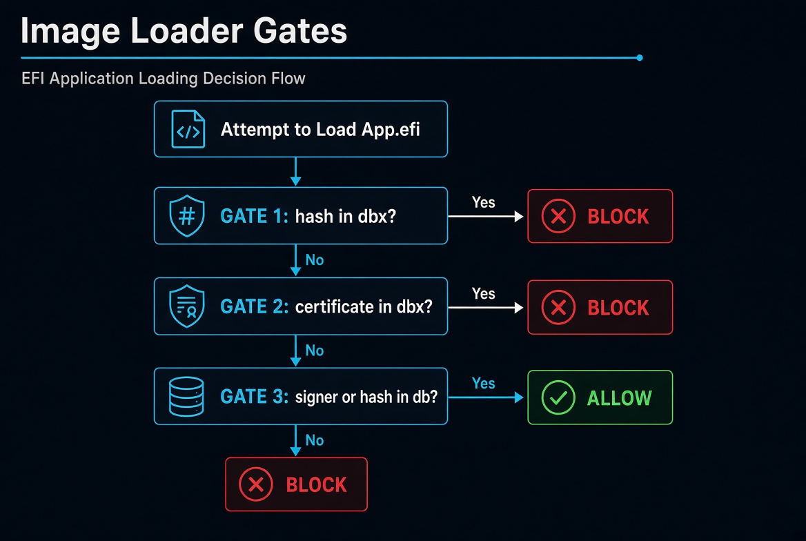

```
  [ Attempt to Load App.efi ]
             |
             v
  GATE 1  hash in dbx?     yes --> BLOCK
             | no
             v
  GATE 2  certificate in dbx?  yes --> BLOCK
             | no
             v
  GATE 3  signer or hash in db?  yes --> ALLOW
             | no
             v
          BLOCK
```

```
  FS0:\*.esl / *.auth / *.cer / *.p7b
            |
            v
  SignatureParserApp scroll menu
            |
            v
  [Block] list size, signature size, type, owner GUID, hash or cert bytes
```

### Win32 diagnostics

Every Win32 tool accepts `--help`, `-h`, `/?`, and `--probe`. `--probe` prints:

```
[*] Firmware type : Uefi | Bios | Unknown
[*] UEFI runtime  : present | not present
[*] TPM device    : present | not present
```

Firmware type comes from `GetFirmwareType`. TPM presence comes from `Tbsi_Context_Create` through `tbs.dll`. NVRAM and TPM operations refuse to continue when the host cannot serve them. SMBIOS, NTFS, and Authenticode still run on a legacy host.

#### `LowLevelBootTools.exe`

Purpose: one elevated inspector for the EFI System Partition, the BCD, the Secure Boot variables, an ESL, and the raw SMBIOS table.

```
LowLevelBootTools.exe --list-boot
LowLevelBootTools.exe --extract-all-keys .\nvram
LowLevelBootTools.exe --parse-esl .\nvram\db.esl
LowLevelBootTools.exe --dump-smbios
```

```
  --list-root / --list-boot
            |
            v
  \\?\GLOBALROOT\SystemPartition\...
            |
            v
  directory listing, or error 3 if the ESP link is absent

  --extract-all-keys
            |
            v
  GetFirmwareEnvironmentVariableW(PK|KEK|db|dbx|dbt)
            |
            +--> .\nvram\*.esl          (UEFI boot)
            +--> ERROR_INVALID_FUNCTION (legacy boot, refused before the call)
```

Error 3 on `--list-boot` is `ERROR_PATH_NOT_FOUND`. Error 1 on a variable read is `ERROR_INVALID_FUNCTION`, which means Windows has no UEFI runtime interface. A missing privilege is 1314, not 1.

#### `ParseSmBios.exe`

Purpose: the typed view of the same RSMB table that `LowLevelBootTools --dump-smbios` prints raw.

```
ParseSmBios.exe --parse-smbios
ParseSmBios.exe --probe
```

```
  GetSystemFirmwareTable('RSMB')
            |
            v
  skip 8-byte RawSMBIOSData header
            |
            v
  Type 0  vendor, version, date
  Type 1  manufacturer, product, serial, UUID
```

SMBIOS is the small table the motherboard firmware publishes so an operating system can learn what the machine is. Vendor, BIOS version, product name, serial, UUID. Windows exposes that table through `GetSystemFirmwareTable` with the signature `RSMB`.

The buffer Windows returns is not the table alone. The first 8 bytes are a header: calling method, SMBIOS major/minor, and the length of the table that follows. The structures start at byte 8. That is the "skip 8-byte RawSMBIOSData header" line.

After that header the table is a sequence of typed records:

- Type 0 is the BIOS record: vendor, version, release date.
- Type 1 is the system record: manufacturer, product name, serial, UUID.

`LowLevelBootTools.exe --dump-smbios` prints the raw buffer, header included, as hex. You see `00 03 00 00 ...` and the string `BIOSE111...` in the pool, but you have to know the layout to read it.

`ParseSmBios.exe --parse-smbios` skips those 8 bytes, walks Type 0 and Type 1, and prints the fields by name.

```
firmware SMBIOS table
        |
        v
Windows RSMB buffer
  [ 8-byte header ][ Type 0 ][ Type 1 ][ ... ]
        |                |         |
        |                |         +--> manufacturer, product, serial, UUID
        |                +--> vendor, version, date
        +--> LowLevelBootTools --dump-smbios prints this whole buffer as hex
```

`--probe` does not parse SMBIOS. It only prints whether this boot is UEFI and whether a TPM is visible, then exits.

#### `WinVerifyTrust.exe`

Purpose: a standalone Authenticode check. The only real argument is a PE path.

```
WinVerifyTrust.exe .\LowLevelBootTools.exe
WinVerifyTrust.exe C:\Windows\System32\ntoskrnl.exe
```

```
  <path-to-pe>
       |
       v
  WinVerifyTrust (UI off, revocation off)
       |
       +--> signed and verified
       +--> not signed
       +--> disallowed / not trusted
       +--> 0x80092003 CRYPT_E_FILE_ERROR if the path does not exist
```

Authenticode is the signature Windows embeds in a PE file: an `.exe`, a `.dll`, or a `.efi`. The signature covers the file bytes and names the certificate that signed them. `WinVerifyTrust` is the Windows API that checks that signature. This tool calls it with the UI turned off and with revocation checks turned off, then prints the result.

What each line means:

- Signed and verified: the file has a signature, the hash matches, and the certificate chains to a root Windows trusts.
- Not signed: the file has no Authenticode table, or the table is not a signature Windows recognizes.
- Disallowed or not trusted: a signature is present, but the publisher or the hash is blocked, or the certificate does not chain to a trusted root.
- `0x80092003` / `CRYPT_E_FILE_ERROR`: the path was not a readable file. This is what `--help` used to produce, because the old binary treated every argument as a file name.

`--help` is usage, not a file name. Pass a real PE path.

```
  bootmgfw.efi / ntoskrnl.exe / any .exe
            |
            v
  embedded Authenticode table
            |
            +--> hash of file matches the signed hash?
            +--> signer certificate chains to a trusted root?
            |
            v
  WinVerifyTrust.exe prints one of the four results above
```

`LowLevelBootTools.exe --parse-boot-file` calls the same API after it has already parsed the PE security directory. This binary is the check alone, with no ESP or NVRAM work.

#### `VerifyRuntimeBoundaries.exe`

Purpose: read `db`, then attempt an unsigned write of `PK`. On a VBS boot the write is dropped because it cannot cross from VTL 0 into VTL 1.

```
VerifyRuntimeBoundaries.exe
VerifyRuntimeBoundaries.exe --probe
```

```
  elevated token
       |
       v
  SeSystemEnvironmentPrivilege
       |
       +--> GetFirmwareEnvironmentVariableW("db")
       +--> SetFirmwareEnvironmentVariableW("PK", unsigned)
                 |
                 +--> ACCESS DENIED / privilege held   (expected on VBS)
                 +--> write accepted                   (lab risk signal)
                 +--> not UEFI                         (refused before the call)
```

`db` is the Secure Boot whitelist, the signature database. Firmware checks a boot file against it. If the file's hash or the certificate that signed it is in `db`, and not in `dbx`, the Image Loader allows the file. `VerifyRuntimeBoundaries.exe` reads `db` first to prove it can see that policy at all.

VBS (Virtualization-Based Security) is the Windows feature that puts those firmware variables behind a hypervisor wall. When it is on, Hyper-V is running under Windows, and the firmware-variable service sits on the protected side.

VTL 0 is the normal Windows you run: user programs, most drivers, the desktop. This executable runs there. Its token can hold `SeSystemEnvironmentPrivilege`, and it can ask to write `PK`.

VTL 1 is the protected side of that wall. The hypervisor removes the physical addresses of the firmware variables from VTL 0. An unsigned write of `PK` from VTL 0 is dropped at that boundary. The tool sees access denied even though it is elevated.

```
VTL 0                          VTL 1
VerifyRuntimeBoundaries.exe    Secure Kernel / firmware variable service
        |                              |
        | read db                      | can touch NVRAM
        | write PK (unsigned)          |
        |                              |
        +------ hypervisor / EPT ------+
                 write is dropped
```

On a boot without VBS, that wall is not there. The same elevated write can succeed. That is the contrast the tool is meant to show.

#### `AuditMeasuredBootLog.exe`

Purpose: open TPM Base Services, copy the TCG event log, and report PCR 0, 4, 7, and 11.

```
AuditMeasuredBootLog.exe
AuditMeasuredBootLog.exe --all
```

```
  Tbsi_Context_Create
       |
       +--> 0x8028400f TBS_E_TPM_NOT_FOUND
       |
       v
  Tbsi_Get_TCG_Log
       |
       v
  PCR 0 firmware
  PCR 4 bootloader
  PCR 7 Secure Boot policy
  PCR 11 BitLocker / VBS
```

Measured Boot is the record of what ran. Each stage that loads the next one hashes that next one and extends a PCR in the TPM. The TPM keeps a running digest. The event log is the list of what was hashed and into which PCR. This tool opens that log through TPM Base Services and prints the PCRs that matter for a Secure Boot check.

What each PCR is holding:

- PCR 0 is the firmware measurement. The platform firmware hashed itself and the early configuration before anything else ran.
- PCR 4 is the bootloader measurement. Firmware hashed the boot manager it loaded, and the boot manager hashed the OS loader.
- PCR 7 is the Secure Boot policy measurement. This is the one that records `PK`, `KEK`, `db`, and `dbx` as they stood when the machine started. A change to the whitelist or the blacklist shows up here.
- PCR 11 is the BitLocker and VBS measurement. Windows extends it when Virtualization-Based Security or disk encryption policy is applied.

`Tbsi_Context_Create` is the first call. It asks Windows for a handle to a TPM. `0x8028400f` is `TBS_E_TPM_NOT_FOUND`: no TPM is visible to this boot. That is expected in a guest launched with `--no-tpm`. The default `02` / `12` path starts swtpm TPM 2.0, so a later Windows/WinPE boot of that VM should see a TPM unless the guest OS lacks a driver. The call itself is the test. On a host with no TPM the tool records that status and exits.

`Tbsi_Get_TCG_Log` copies the event log once the handle exists. The usage text advertises `--all` as a full-event dump, but `wmain` never branches on `--all`, so the report is always the focused PCR 0, 4, 7, and 11 set. `--probe` prints the firmware/TPM probe and exits.

```
firmware  --hash-->  PCR 0
bootmgr   --hash-->  PCR 4
PK/KEK/db/dbx policy --hash-->  PCR 7
VBS / BitLocker --hash-->  PCR 11
        |
        v
  TCG event log
        |
        v
  AuditMeasuredBootLog.exe
```

A matching pair with `VerifyRuntimeBoundaries.exe` is useful: one shows whether an unsigned write of `PK` is blocked now, the other shows whether the policy that was active at boot was measured into PCR 7.

#### `DumpNtfsVolume.exe`

Purpose: open a volume, ask NTFS for `MftStartLcn`, and dump the first bytes of `$MFT` to stdout. This is a separate forensic tool. It does not sit on the lab thread.

```
DumpNtfsVolume.exe --volume \\.\C: --bytes 256
```

```
  \\.\C:
     |
     v
  FSCTL_GET_NTFS_VOLUME_DATA
     |
     v
  seek to MftStartLcn * BytesPerCluster
     |
     v
  first N bytes
     |
     +--> 46 49 4C 45   FILE magic, record boundary confirmed
```

`$MFT` is the Master File Table. It is a file inside the NTFS volume, not a firmware object and not an ESP object. Every file and directory on the volume has a record in it. The first record is the `$MFT` itself. Its first four bytes are the ASCII magic `FILE` (`46 49 4C 45`). Seeing that magic means the seek landed on a record boundary, not in the middle of a cluster.

The tool does not open the ESP. It opens the NTFS volume you name, for example `\\.\C:`. `FSCTL_GET_NTFS_VOLUME_DATA` returns the geometry: bytes per cluster, and the logical cluster number where `$MFT` starts (`MftStartLcn`). The tool multiplies that by the cluster size, seeks there, and reads the number of bytes you asked for. It prints `BytesPerCluster`, `MftStartLcn`, and the hex dump to stdout. It does not write a file.

`--bytes 256` is enough to cover the record header and the fixed fields that follow it: update sequence, sequence number, first attribute offset. The bytes are only a yes or no. If the first four are `FILE`, the volume open and the MFT seek worked. If they are anything else, the seek is wrong or the volume is not NTFS. The tool does not parse the rest of the header.

There is no injection path. `SecureManagerApp.efi` takes `.auth` packets. `SignatureParserApp.efi` takes an EFI image. `LowLevelBootTools.exe` takes an ESP path, an `.esl`, or a BCD. None of them take an MFT dump. Feeding the 256 bytes into any of them would be a type error.

It needs an elevated token and share-read plus share-write on the volume handle. It does not need UEFI and it does not need a TPM. A failed open is a privilege or a path problem, not a firmware problem.

```
NTFS volume (\\.\C:)
        |
        v
  FSCTL_GET_NTFS_VOLUME_DATA
        |
        +--> BytesPerCluster
        +--> MftStartLcn
        |
        v
  seek to MftStartLcn * BytesPerCluster
        |
        v
  first N bytes of $MFT  (stdout)
        |
        +--> 46 49 4C 45  FILE  record 0 starts here
```

This is the contrast with the other two forensic tools. The lab thread is the Secure Boot path: certificates, `.auth` packets, enrollments, the ESP, the firmware-variable probes, and the measured-boot PCR check. `DumpNtfsVolume.exe` never touches any of that. It is in the suite so a forensic pass can tell three objects apart:

```
ESP (FAT32, firmware)                 LowLevelBootTools.exe --list-boot
SMBIOS table (firmware published)     ParseSmBios.exe --parse-smbios
NTFS $MFT (file system)               DumpNtfsVolume.exe --volume \\.\C:
```

A failed ESP open, a missing SMBIOS field, and a bad MFT seek are three different failures. The tool exists so the third one is not mistaken for one of the first two. It is not a step in the enrollment or the measured-boot lab.

## Tests

From the repository root:

```
./tests/run_tests.sh
./tests/run_tests.sh -k "not test_headless_ovmf"   # skip the live QEMU boot
```

The suite uses pytest (`python3-pytest` on Debian). It covers:

- `bash -n` and `shellcheck -x` on the lab scripts
- Auth2 packet structure (`03_generate_auth_update.sh`, `09_sign_db_with_kek.sh`, `scripts/lib/auth2.sh`), including the 16-byte `EFI_TIME` `2026-10-04 23:30:00` UTC, the `WIN_CERTIFICATE_UEFI_GUID` header, and OpenSSL CMS verification
- Idempotent `11_extract_and_patch_iso.sh` / `13_patch_winpe_image.sh` on a fixture ISO
- QEMU `--dry-run` command shape, `--empty-keys`, and OVMF CODE-mismatch abort unless `--reset-vars` is passed
- A headless OVMF + SMM + swtpm boot when the toolchain is present (see [QEMU lab features](#qemu-lab-features) for what is asserted versus skipped)

## License

This project is licensed under the [MIT License](LICENSE). Copyright (c) 2026 Damian Andres Ulanowicz.

Third-party components and tools keep their own licenses; see [THIRD_PARTY_NOTICES.md](THIRD_PARTY_NOTICES.md).
