# Diagram sources (Mermaid)

Text sources for the assets in this suite. Paste any block into a Mermaid renderer (GitHub, mermaid.live, VS Code Mermaid preview) to re-draw the diagram.

Dark theme is assumed. The original images used a navy background with cyan and white text.

## 01-boot-chain

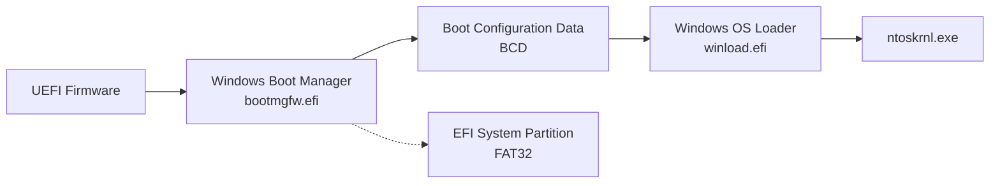

## 02-execution-phases

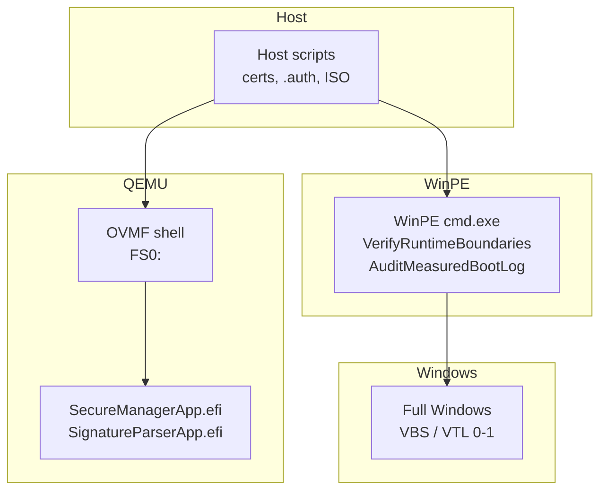

## 03-enrollment-order

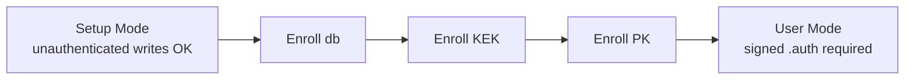

## 04-vtl-architecture

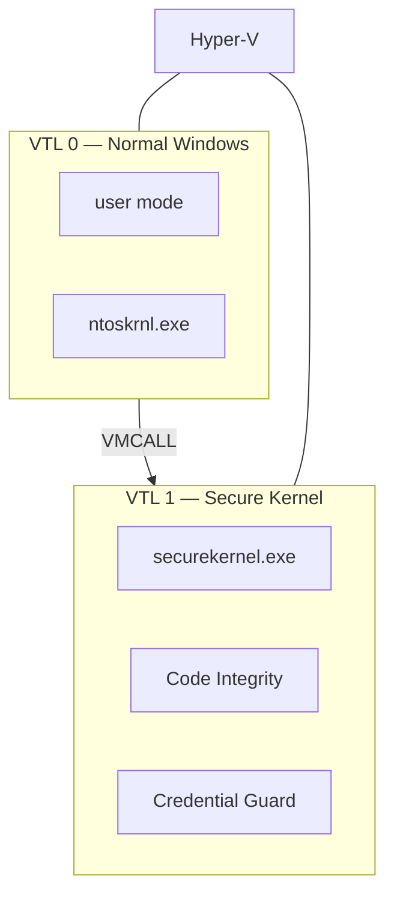

## 05-physical-keys-to-qemu

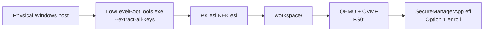

## 06-boot-manager-policy

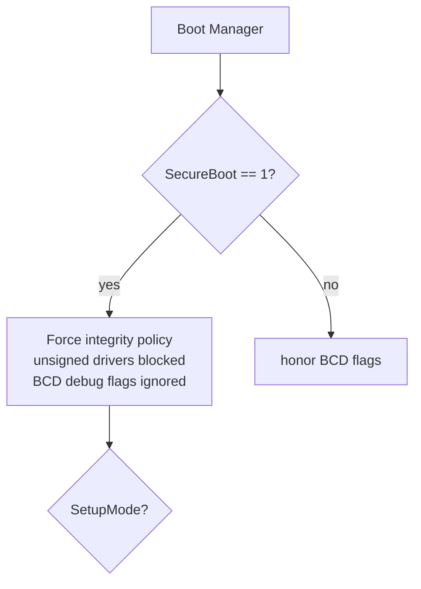

## 07-nvram-vtl-isolation

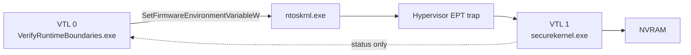

## 08-credential-guard

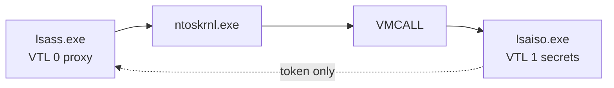

## 09-ept-translation

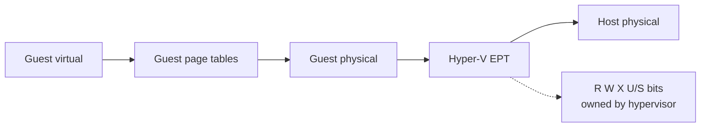

## 10-hvci-wx

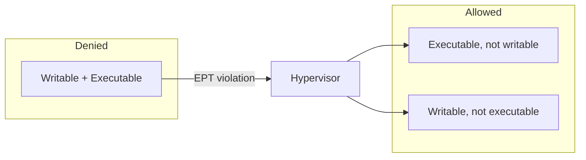

## 11-esp

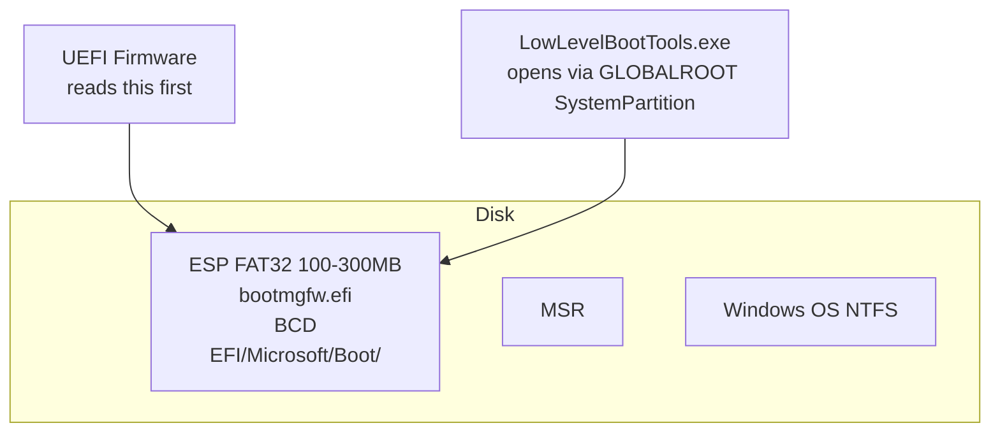

## 12-vbs

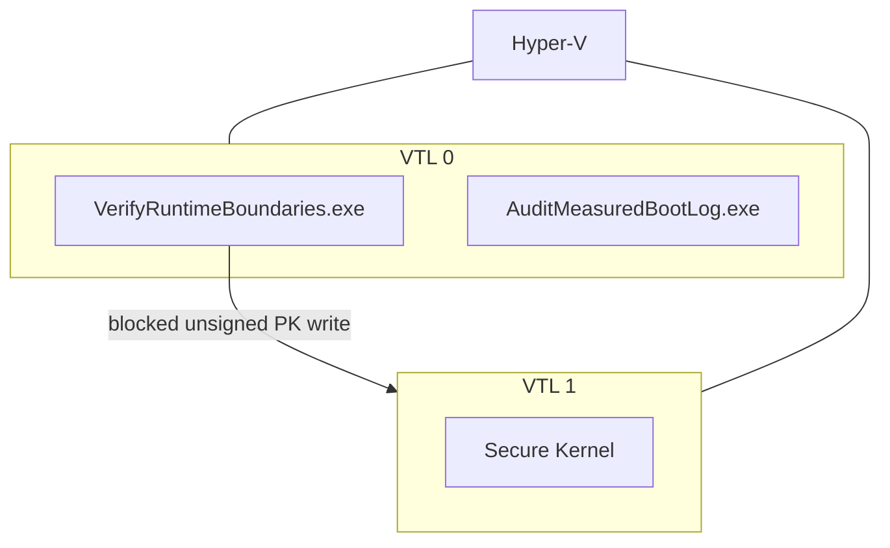

## 14-winpe

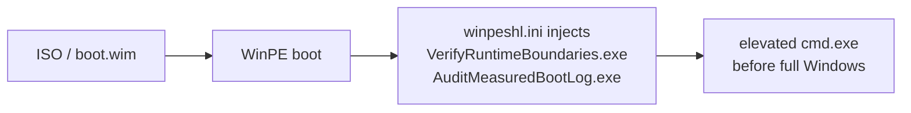

## 15-secure-boot-databases

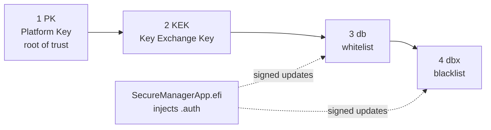

## 16-measured-boot-tpm

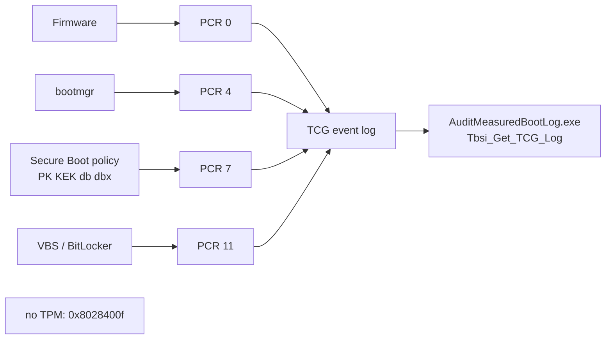

## 17-qemu-ovmf-nvram

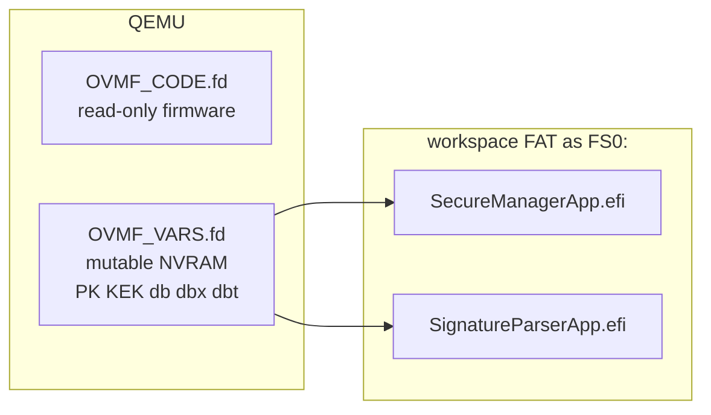

## 18-win32-tools-touching

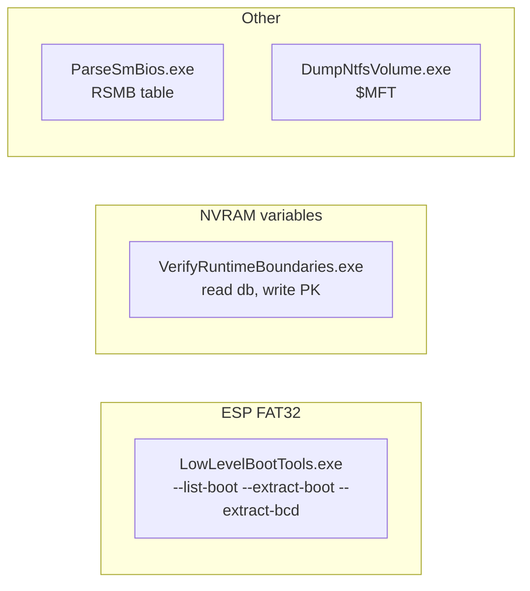

## 19-image-loader-gates

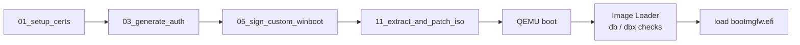

## 20-signature-lists-keys

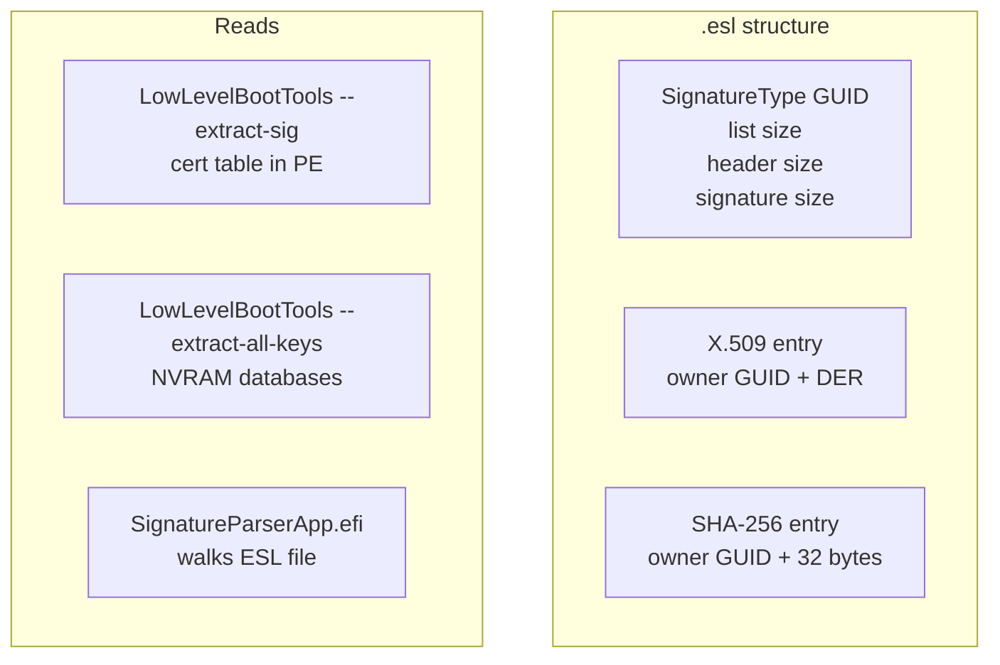

## 21-authenticated-packets

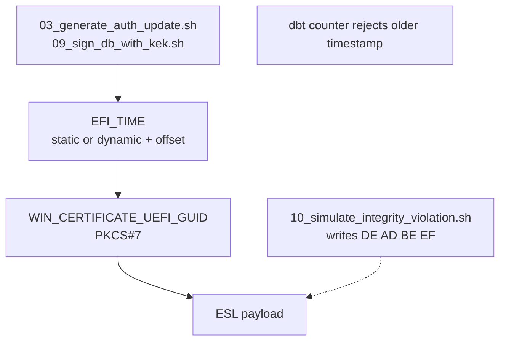

## 22-media-winpe-long-path

```mermaid
flowchart TD
    A[01_setup_certs.sh] --> B[deploy_suite.sh]
    B --> C[02_run_qemu.sh<br/>enroll into OVMF_VARS.fd]
    C --> D[11_extract_and_patch_iso.sh]
    D --> E[13_patch_winpe_image.sh<br/>inject tools + winpeshl.ini]
    E --> F[12_run_patched_iso_qemu.sh]
```

## 23-image-loader-gates

```mermaid
flowchart TD
    START[Attempt to Load App.efi]
    G1{GATE 1<br/>hash in dbx?}
    G2{GATE 2<br/>certificate in dbx?}
    G3{GATE 3<br/>signer or hash in db?}
    B1[BLOCK]
    B2[BLOCK]
    ALLOW[ALLOW]
    B3[BLOCK]
    START --> G1
    G1 -->|yes| B1
    G1 -->|no| G2
    G2 -->|yes| B2
    G2 -->|no| G3
    G3 -->|yes| ALLOW
    G3 -->|no| B3
```
